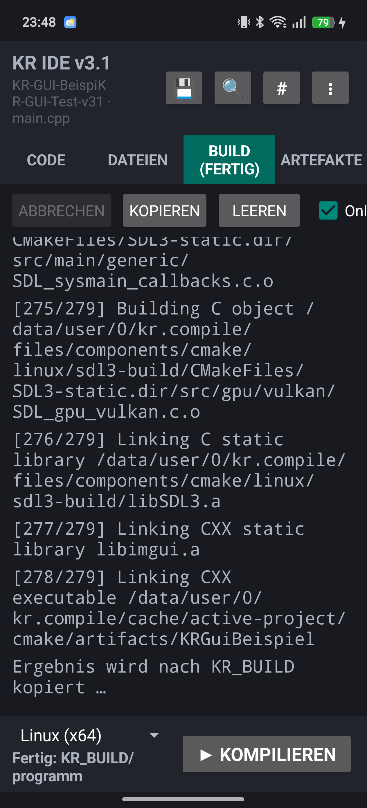
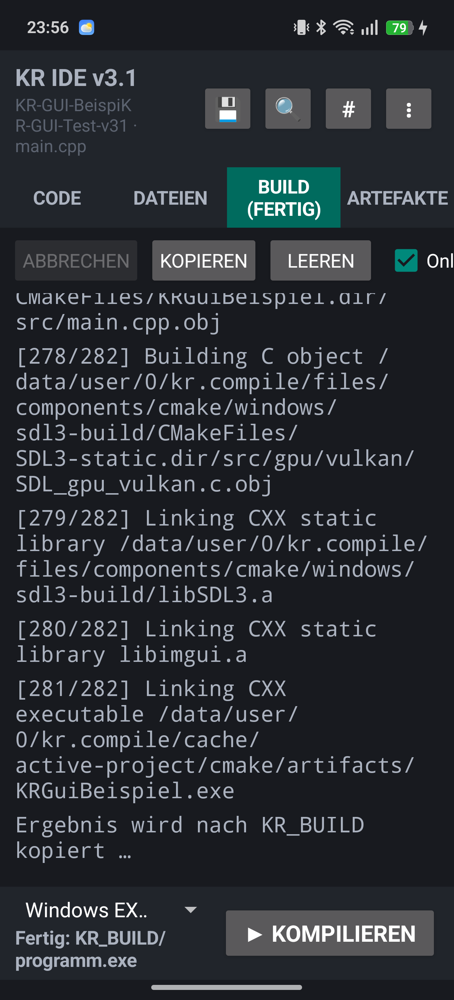
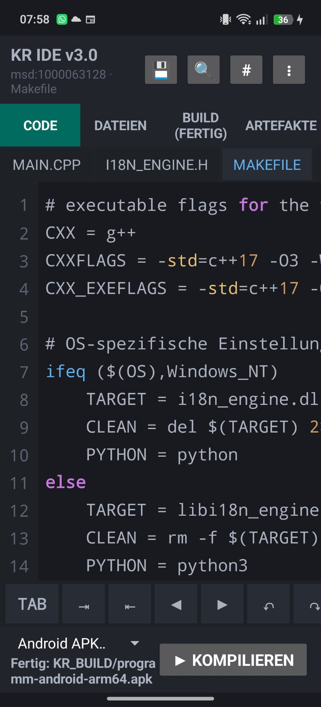
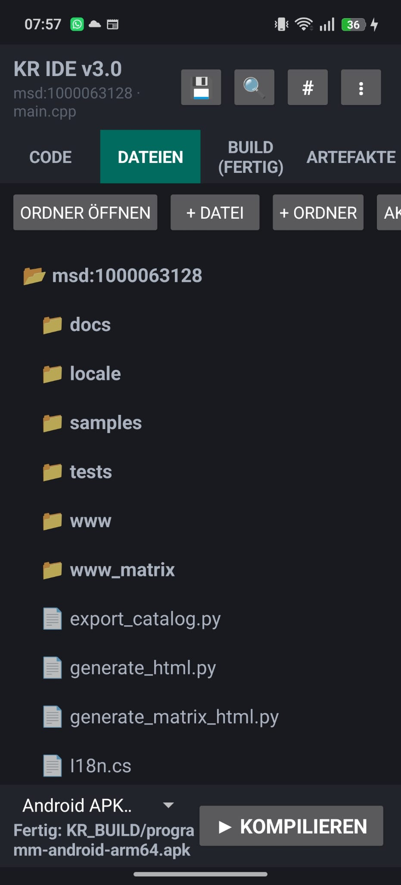
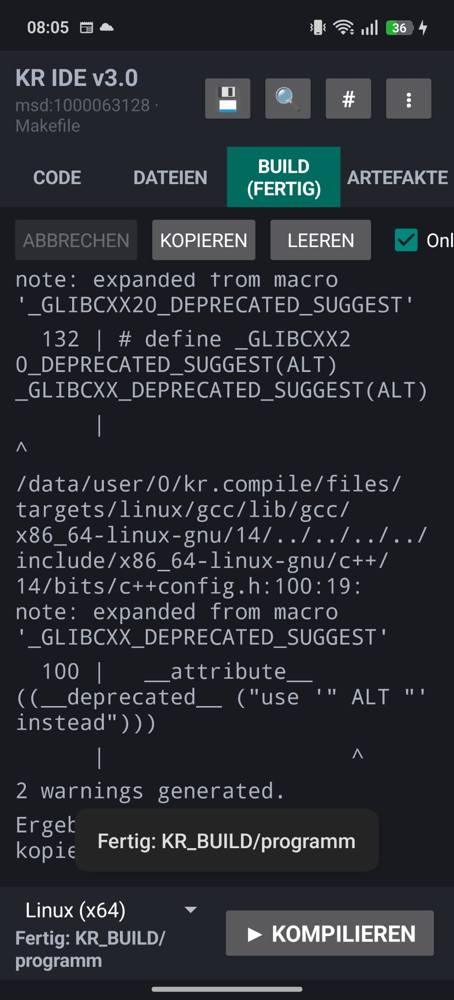
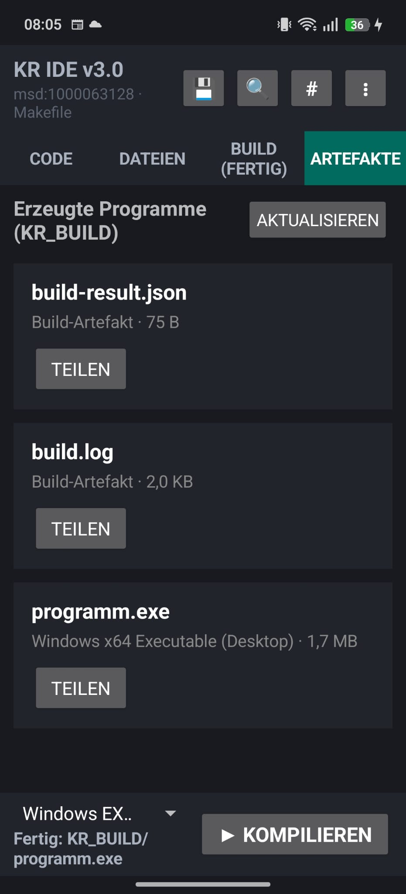

# KR Compiler Android IDE

KR Compiler Android IDE ist eine mobile C- und C++-Entwicklungsumgebung für ARM64-Android-Geräte. Projekte können direkt auf dem Smartphone geöffnet, bearbeitet und mit der integrierten Clang/LLVM-, CMake- und Ninja-Werkzeugkette gebaut werden. Als Ziele stehen Android ARM64, Windows x64 und Linux x64 zur Verfügung.

## Version 3.2 herunterladen

Die installierbare APK und drei deutschsprachige Dokumentationen befinden sich im [GitHub-Release v3.2.0](https://github.com/kruemmel-python/KR-Compiler/releases/tag/v3.2.0). Das unveränderte große Compiler-Werkzeugpaket wird weiterhin geprüft aus Release v3.1.0 geladen.

Voraussetzungen:

- Android 8.0 oder neuer
- ARM64-Gerät (`arm64-v8a`)
- rund 2 GiB freier Speicher für APK, entpackte Compilerlaufzeit und Builds

## Neu: GUI für Android, Windows und Linux

Version 3.2 kann neben Konsolenprogrammen grafische C++-Anwendungen für Android ARM64, Windows x64 und Linux x64 bauen:

- gemeinsame Projektvorlage mit SDL3 und Dear ImGui
- vcpkg-Abhängigkeiten direkt in der Android-Oberfläche auswählen
- automatische Verwaltung von `vcpkg.json` und CMake-Toolchain
- nativer SDLActivity-Runner mit Touch und OpenGL ES für Android
- Linux-GUI-Profil mit X11/Xext sowie Windows-GUI-Profil mit MinGW
- getestetes Beispielprojekt unter `android/tests/gui-vcpkg`

| Android-GUI bauen | Android-GUI ausführen |
|---|---|
|  |  |

| Linux x64 erfolgreich | Windows x64 erfolgreich |
|---|---|
|  |  |

Die vollständige Schrittfolge steht im [bebilderten Benutzerhandbuch v3.2](docs/BENUTZERHANDBUCH_v3.2.md).

## Mobile Entwicklungsumgebung

| Editor | Projektdateien |
|---|---|
|  |  |

| Buildausgabe | Artefakte |
|---|---|
|  |  |

Die IDE bietet:

- Quelltexteditor mit Dateireitern, C/C++-Syntaxdarstellung und mobiler Symbolleiste
- Dateiansicht sowie Befehle zum Anlegen von Dateien und Ordnern
- Suche und Ersetzen, Zeilennavigation und einstellbare Editoroptionen
- Import öffentlicher GitHub-Repositories über ihre URL
- getrennte Ansichten für Buildprotokoll und erzeugte Dateien
- Teilen von `build.log`, `build-result.json` und fertigen Programmen
- automatische Hoch- und Querformatdarstellung für Smartphones und Tablets
- GUI-Projektvorlage und vcpkg-Bibliotheksverwaltung
- native Android-GUI-Paketierung über SDLActivity

## Compiler und Zielsysteme

- `CMakeLists.txt` mit dem enthaltenen CMake und Ninja auswerten
- C/C++-Projekte ohne CMake als Einzelprogramm bauen
- Android-ARM64-Runner-APKs erzeugen und signieren
- Windows-x64-Programme (`programm.exe`) cross-kompilieren
- Linux-x64-Programme (`programm`) cross-kompilieren
- CMake `FetchContent` und Git-Zugriffe optional erlauben
- bekannte CMake-Pakete wie `fmt`, `nlohmann_json`, `spdlog`, `Catch2` und `Eigen3` kontrolliert laden
- Projektressourcen mit erhaltener Ordnerstruktur in Android-Runner-APKs übernehmen

Ein CMake-Projekt muss für Android ein ausführbares Ziel mit `add_executable` bereitstellen. Bei mehreren ausführbaren Zielen kann der gewünschte Name in `kr-android-target.txt` stehen. Plattformgebundener Code und nicht vorhandene proprietäre SDKs können nicht automatisch portiert werden.

## Dokumentation

- [Benutzerhandbuch v3.2 mit Android-, Windows- und Linux-GUI](docs/BENUTZERHANDBUCH_v3.2.md)
- [Benutzerhandbuch v3.2 als Word-Datei](docs/KR_Compiler_Android_Benutzerhandbuch_v3.2_15-10-2026.docx)
- [Technische Dokumentation v3.2](docs/KR_Compiler_Android_Dokumentation_v3.2_15-10-2026.docx)
- [Projektgeschichte Kreta und KR IDE v3.2](docs/KR_Compiler_Android_Kreta_Geschichte_v3.2_15-10-2026.docx)

- [Benutzerhandbuch v3.1 mit allen GUI-Schritten](docs/BENUTZERHANDBUCH_v3.1.md)
- [Benutzerhandbuch v3.1 als Word-Datei](docs/KR_Compiler_Android_Benutzerhandbuch_v3.1_15-10-2026.docx)
- [Technische Dokumentation v3.1](docs/KR_Compiler_Android_Dokumentation_v3.1_15-10-2026.docx)
- [Projektgeschichte Kreta und KR IDE v3.1](docs/KR_Compiler_Android_Kreta_Geschichte_v3.1_15-10-2026.docx)
- [Technische Dokumentation v3.0](docs/KR_Compiler_Android_Dokumentation_v3.0_14-10-2026.docx)
- [Projektgeschichte Kreta und KR IDE v3.0](docs/KR_Compiler_Android_Kreta_Geschichte_v3.0_14-10-2026.docx)
- [Technische Hinweise zum Android-Projekt](android/README.md)

## Repository forken und selbst bauen

Benötigt werden Windows, PowerShell, JDK 17 sowie das Android SDK mit API 35, Build Tools und NDK `27.0.12077973`.

```powershell
git clone https://github.com/DEIN-NAME/KR-Compiler.git
cd KR-Compiler
powershell -ExecutionPolicy Bypass -File .\android\scripts\build-apk.ps1
```

Beim ersten Build lädt das Skript die geprüfte Compilerlaufzeit aus Release v3.1.0. Anschließend erzeugt es ausschließlich lokal einen Entwicklungsschlüssel. Weder der Werkzeugkasten noch private Schlüssel werden im Git-Repository gespeichert. Die fertige APK liegt unter `android/app/build/outputs/apk/release/app-release.apk` und zusätzlich als `KR-Compiler-Android-IDE-v3.2.apk` im Repository-Arbeitsordner.

Für eine eigene dauerhafte Release-Signatur können diese Umgebungsvariablen gesetzt werden:

- `KR_SIGNING_STORE`
- `KR_SIGNING_STORE_PASSWORD`
- `KR_SIGNING_KEY_ALIAS`
- `KR_SIGNING_KEY_PASSWORD`

Die GitHub-Action unter `.github/workflows/android-build.yml` führt denselben Build bei jedem Push und Pull Request aus. Ein Fork kann sie ohne zusätzliche Geheimnisse starten; das Ergebnis wird als Workflow-Artefakt bereitgestellt.

## Projektstruktur

- `android/app`: Editor, Projektverwaltung, Compilersteuerung und APK-Paketierung
- `android/runner`: kleine Laufzeit-App für erzeugte Android-Programme
- `android/scripts`: Download, lokale Signierung und reproduzierbarer APK-Build
- `android/tests`: CMake-, Abhängigkeits- und Kernfunktionstests
- `docs`: Dokumentationen und aktuelle Android-Screenshots

## Sicherheit und Lizenzen

Online-Abhängigkeiten und GitHub-Importe sind ausdrückliche Benutzeraktionen. Fremde Projektdateien und CMake-Skripte sind ausführbarer Buildinhalt und sollten nur aus vertrauenswürdigen Quellen geöffnet werden.

Der Quellcode dieses Repositorys steht unter GPL-3.0. Die eingebettete Laufzeit enthält Komponenten unter eigenen Open-Source-Lizenzen; siehe [THIRD_PARTY_NOTICES.md](THIRD_PARTY_NOTICES.md) und die Lizenzdateien innerhalb der jeweiligen Release-Komponenten.
