# KR Compiler Android IDE v3.1 – Benutzerhandbuch

Dieses Handbuch zeigt den auf einem echten Android-Gerät geprüften Ablauf für ein gemeinsames grafisches C++-Projekt, das mit SDL3, Dear ImGui, CMake und vcpkg für Linux x64 und Windows x64 gebaut wird.

Die ausführliche Fassung mit Hinweisen und Fehlerbehebung steht auch als [Word-Handbuch](KR_Compiler_Android_Benutzerhandbuch_v3.1_15-10-2026.docx) bereit.

## 1. App öffnen

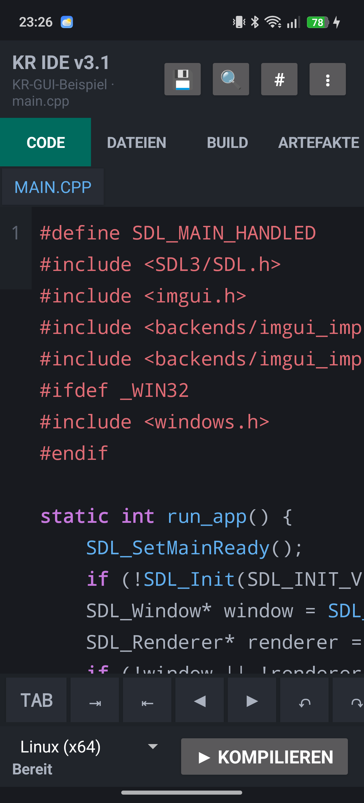

KR Compiler starten und die Projektansicht öffnen.

## 2. GUI-Funktionen öffnen

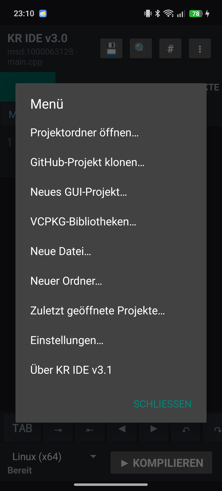

Im Projektmenü stehen **Neues GUI-Projekt** und **vcpkg-Bibliotheken** bereit.

## 3. GUI-Projekt anlegen

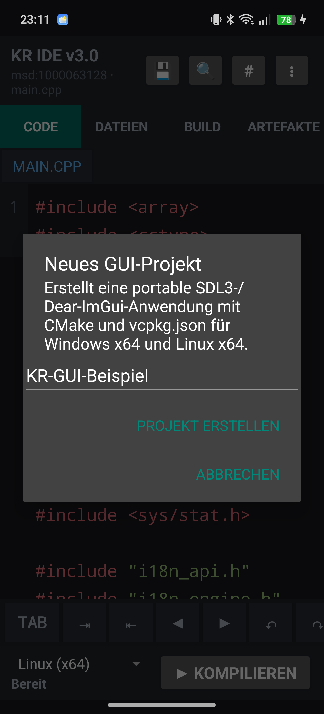

Einen Projektnamen eingeben und bestätigen. Die Vorlage erzeugt CMake, `vcpkg.json`, `src/main.cpp` sowie die Kennzeichnung als Desktop-GUI-Projekt.

## 4. Projektdateien prüfen

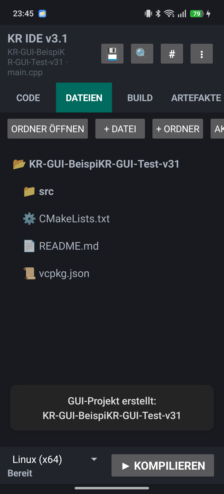

In der Dateiansicht `CMakeLists.txt`, `vcpkg.json`, `src/main.cpp` und `kr-gui-target.txt` kontrollieren.

## 5. vcpkg-Bibliotheken verwalten

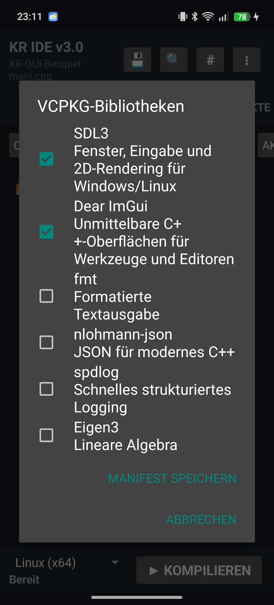

Benötigte Pakete auswählen und speichern. Die Auswahl wird reproduzierbar in `vcpkg.json` festgehalten.

## 6. Linux x64 bauen

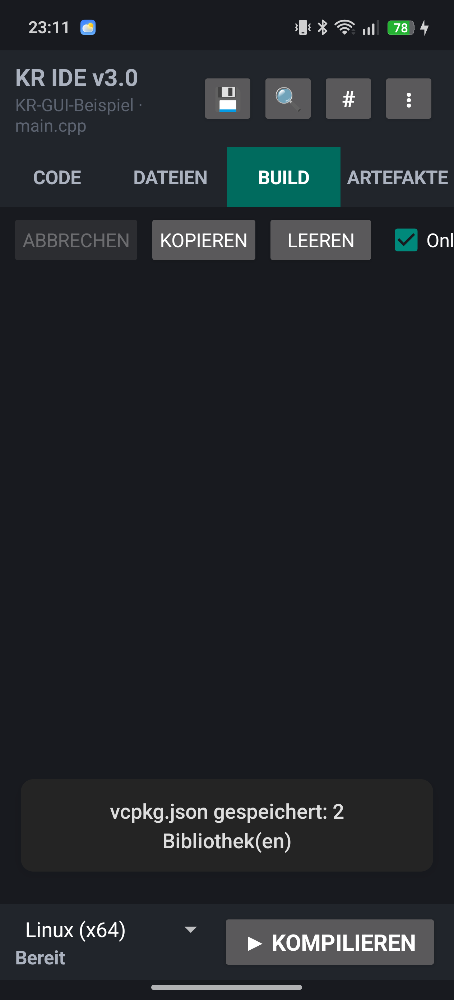

Linux x64 auswählen und den Build starten.

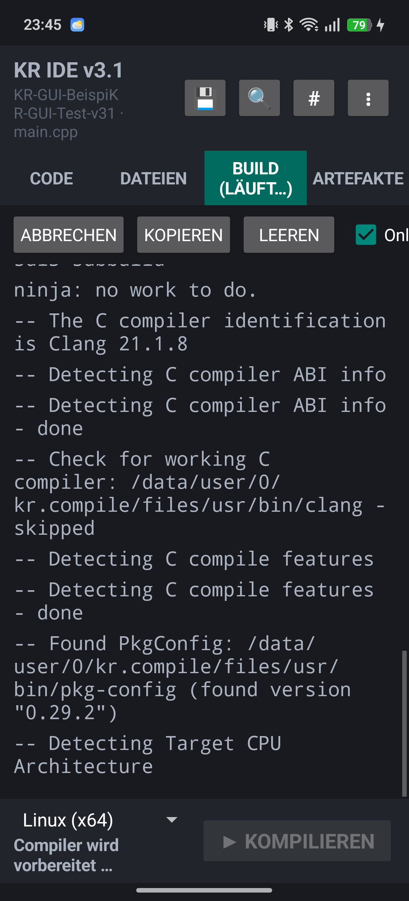

CMake, vcpkg und Ninja werden automatisch eingerichtet.

Der Gerätetest wurde erfolgreich abgeschlossen.

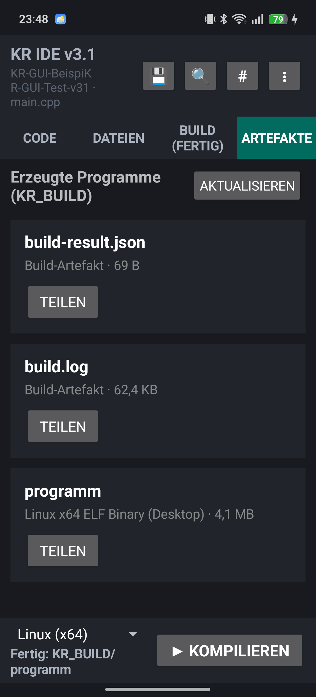

Ergebnis: `programm`, Linux x64 ELF Binary (Desktop), etwa 4,1 MB.

## 7. Windows x64 bauen

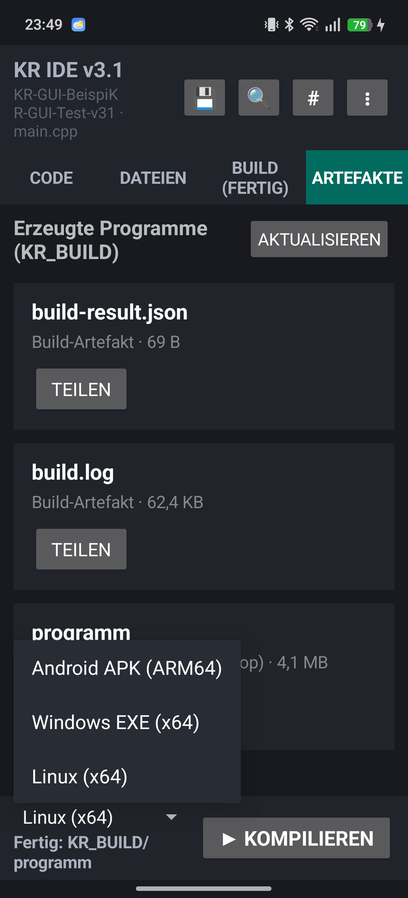

Ohne Änderung am Projekt auf Windows x64 umstellen.

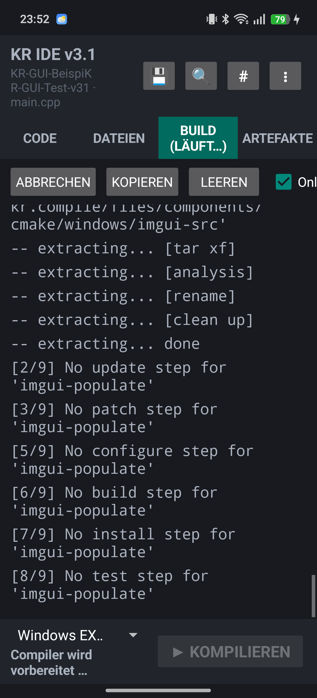

Den Build mit dem Windows-Cross-Compilerprofil starten.

Auch der Windows-GUI-Build wurde erfolgreich abgeschlossen.

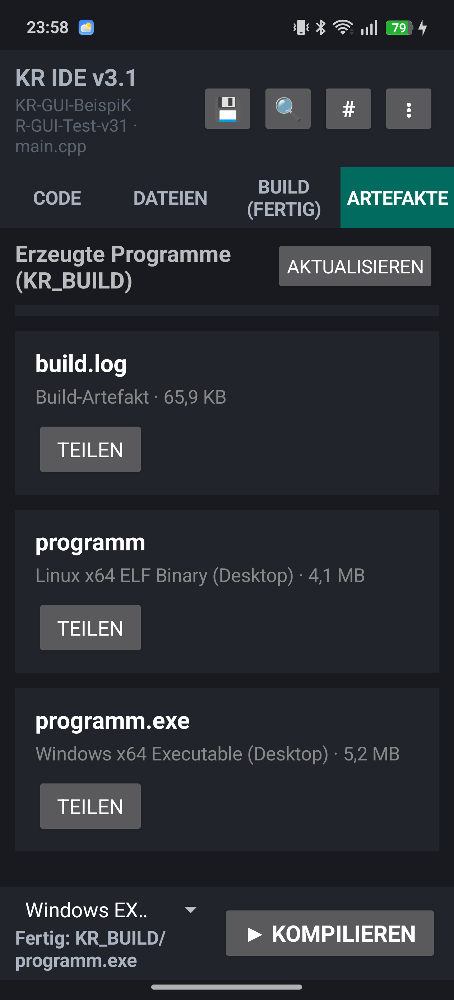

Ergebnis: `programm.exe`, Windows x64 Executable (Desktop), etwa 5,2 MB.

## Hinweise

- Windows- und Linux-Artefakte werden auf dem jeweiligen Desktop-Zielsystem ausgeführt, nicht auf Android.
- Beim erstmaligen Laden zusätzlicher vcpkg-Pakete ist eine Internetverbindung erforderlich.
- CMake-Projekte und vcpkg-Manifeste können Buildbefehle und Downloads auslösen. Nur vertrauenswürdige Projekte öffnen.
- Bei einem Fehler `build.log` und `build-result.json` in der Artefaktansicht prüfen oder teilen.

Teststand: KR Compiler Android IDE 3.1.0 auf RMX3853, 15. Oktober 2026.
