# KR Compiler Android IDE v3.2 – Benutzerhandbuch

Dieses Handbuch zeigt den auf einem echten Android-Gerät geprüften Ablauf für ein gemeinsames grafisches C++-Projekt mit SDL3, Dear ImGui, CMake und vcpkg. Dasselbe Projekt lässt sich als Android-APK, Windows-x64-EXE und Linux-x64-Programm bauen.

Die ausführliche Fassung mit allen Einzelschritten und der Fehlerbehebung steht als [Word-Handbuch](KR_Compiler_Android_Benutzerhandbuch_v3.2_15-10-2026.docx) bereit.

## 1. App und Projektmenü öffnen

| App starten | Projektmenü öffnen |
|---|---|
| 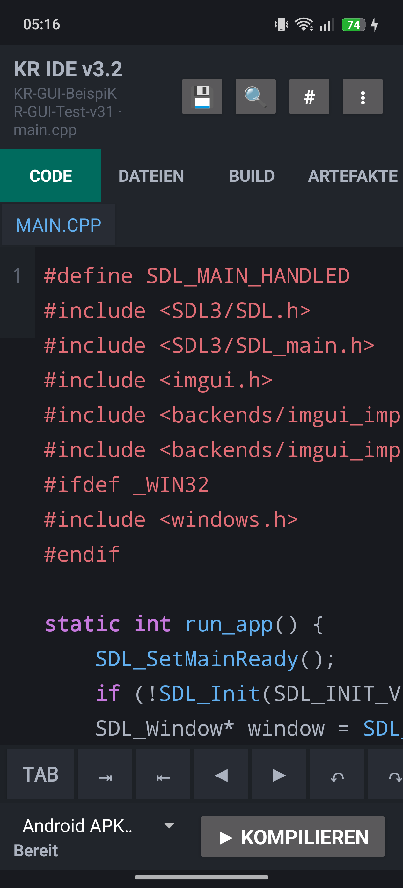 | 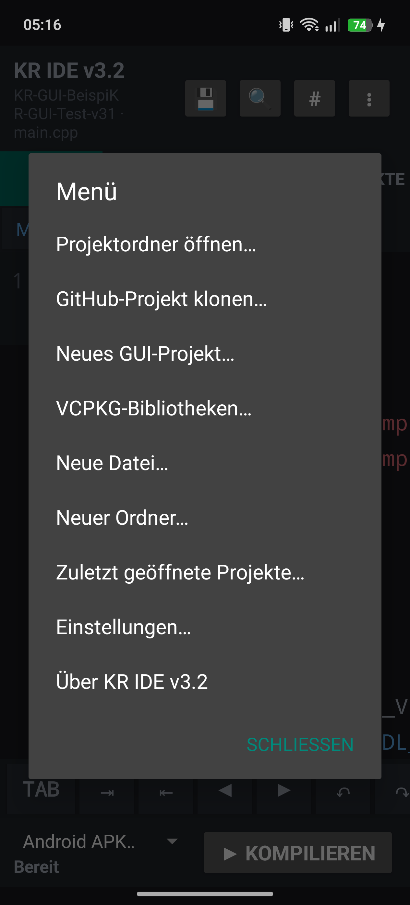 |

Im Projektmenü **Neues GUI-Projekt** wählen.

## 2. GUI-Projekt anlegen

| Projektnamen eingeben | Erzeugte Dateien prüfen |
|---|---|
| 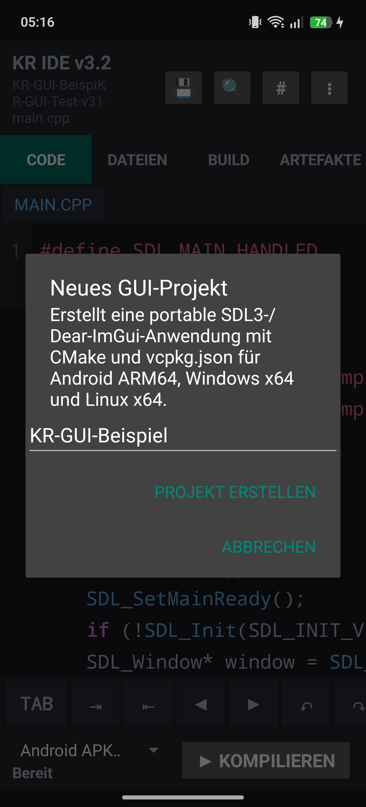 | 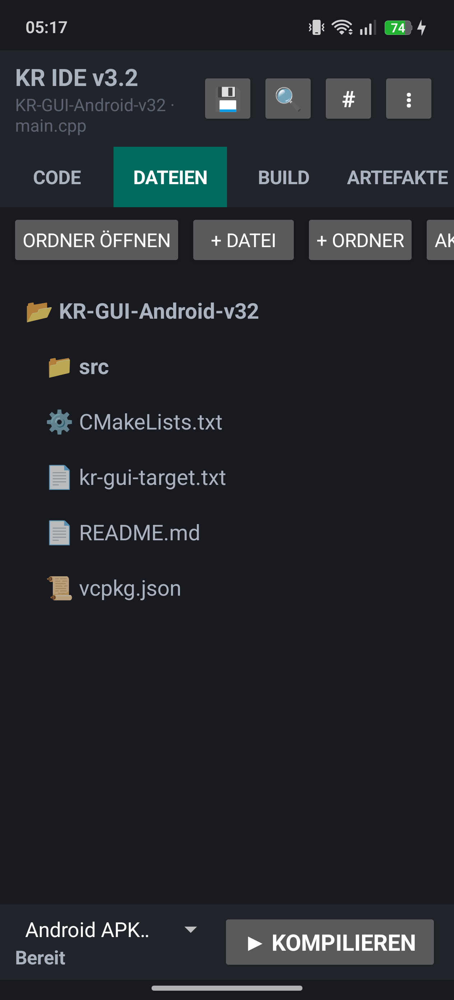 |

Die Vorlage erzeugt `CMakeLists.txt`, `vcpkg.json`, `src/main.cpp` und `kr-gui-target.txt`. Die Zielkennzeichnung gilt für Android, Windows und Linux.

## 3. Bibliotheken auswählen

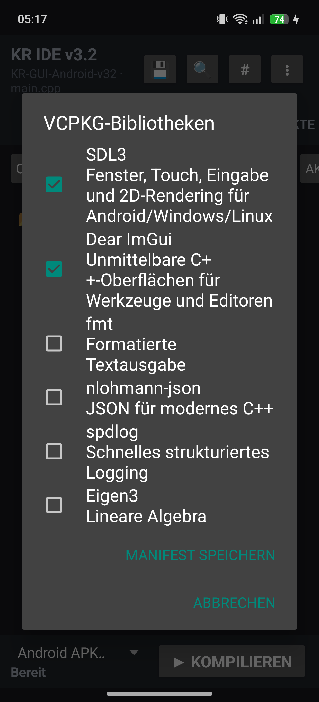

SDL3 und Dear ImGui sind für die GUI-Vorlage aktiviert. Weitere unterstützte Pakete lassen sich im selben Dialog ergänzen; die Auswahl wird in `vcpkg.json` gespeichert.

## 4. Android-APK bauen

| Android-Ziel bereit | Nativer Build läuft |
|---|---|
| 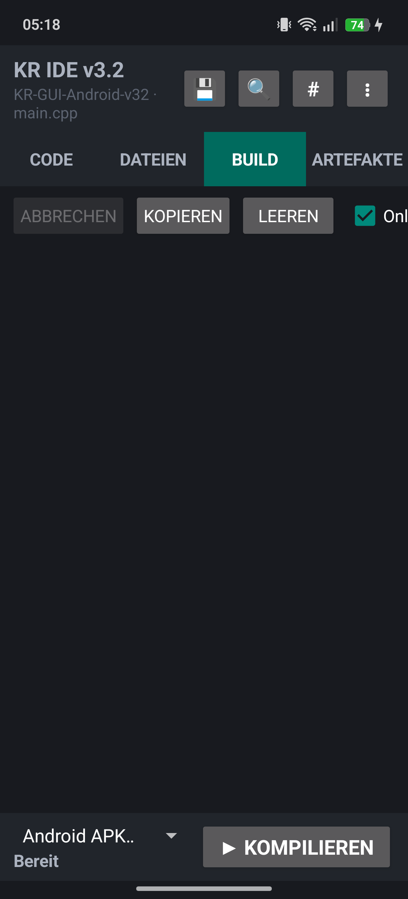 | 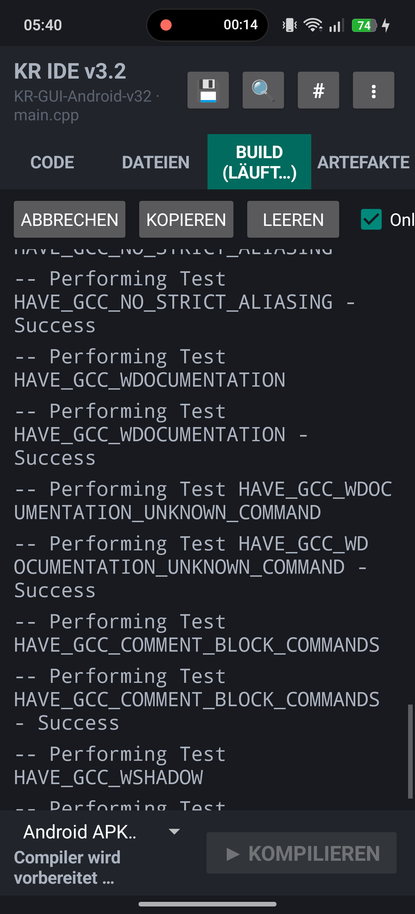 |

Unten **Android APK** auswählen und **Kompilieren** drücken. Beim ersten GUI-Build werden SDL3 und Dear ImGui eingerichtet; dieser Lauf benötigt entsprechend mehr Zeit.

| Build erfolgreich | APK-Artefakt |
|---|---|
| 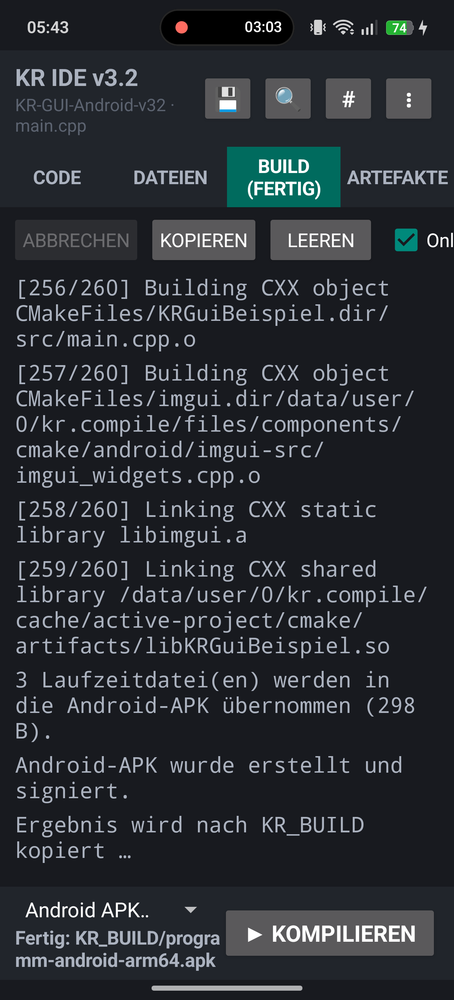 | 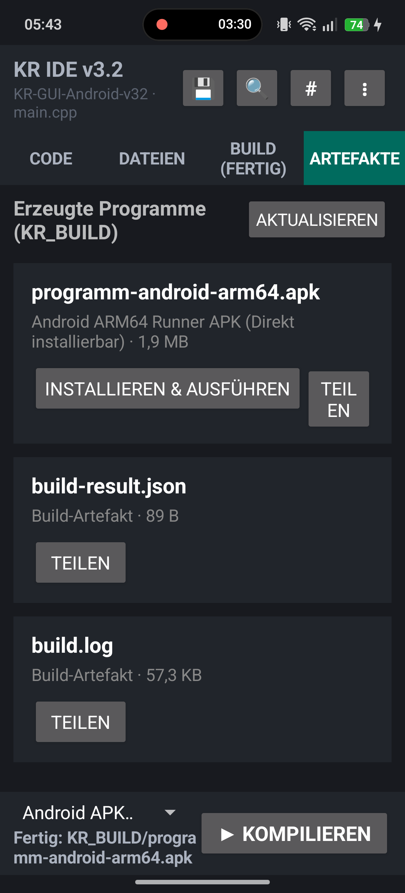 |

Das Ergebnis ist `programm-android-arm64.apk` und kann direkt auf dem Smartphone installiert werden.

## 5. Installieren und ausführen

| Android-Installation bestätigen | Natives GUI-Fenster |
|---|---|
| 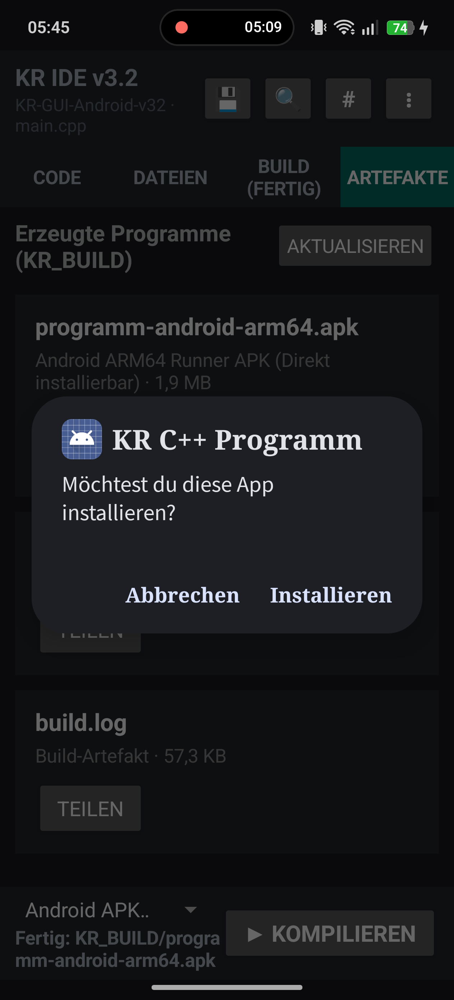 | 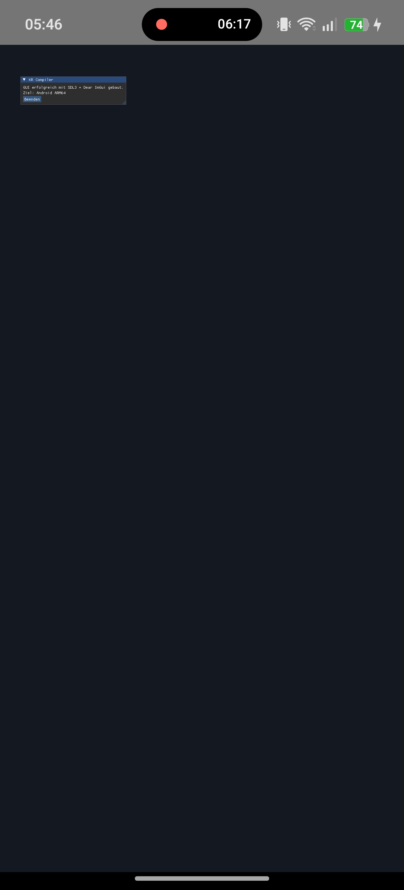 |

**Installieren & Ausführen** wählen und die Android-Abfrage bestätigen. Der SDLActivity-Runner startet anschließend die native SDL3-/Dear-ImGui-Oberfläche.

## 6. Windows x64 und Linux x64

Für die Desktop-Ziele wird dasselbe Projekt verwendet. Zielplattform umstellen und erneut kompilieren:

- Linux x64 erzeugt `programm` als ELF-Desktopprogramm. [Bebilderter Testlauf](BENUTZERHANDBUCH_v3.1.md#6-linux-x64-bauen)
- Windows x64 erzeugt `programm.exe` als Windows-Desktopprogramm. [Bebilderter Testlauf](BENUTZERHANDBUCH_v3.1.md#7-windows-x64-bauen)

## Fehlerbehebung

| Meldung | Lösung |
|---|---|
| SDL sucht X11 oder Wayland | Version 3.2 installieren. Sie aktiviert das Android-Backend und SDLActivity ausdrücklich. |
| GLES-Header fehlt | Die vollständige v3.2-APK verwenden; sie richtet EGL- und OpenGL-ES-Header automatisch ein. |
| Installation wird blockiert | In Android die Installation aus KR Compiler erlauben und die Paketabfrage bestätigen. |
| Vorhandener Runner hat eine andere Signatur | Den alten Eintrag **KR C++ Programm** deinstallieren und das neue Artefakt erneut installieren. Die Projektdateien in KR Compiler bleiben erhalten. |

Teststand: KR Compiler Android IDE 3.2.0 auf RMX3853, 15. Oktober 2026.
