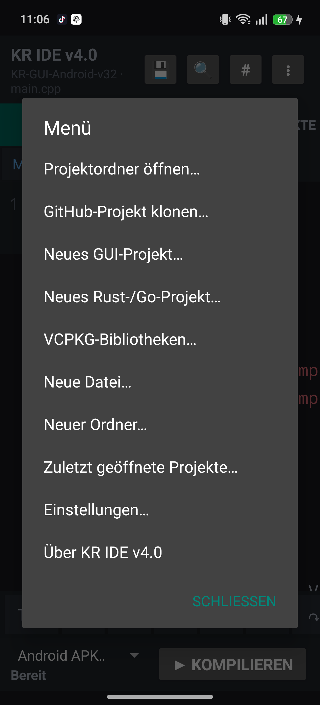
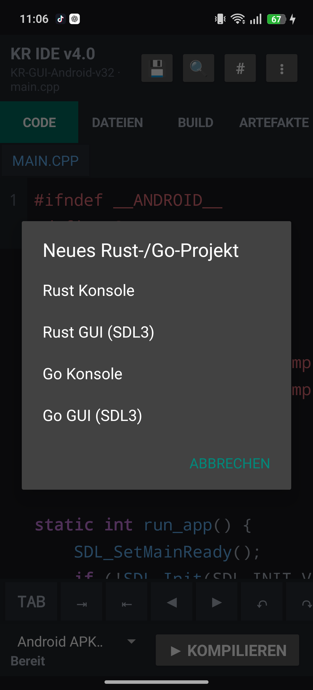
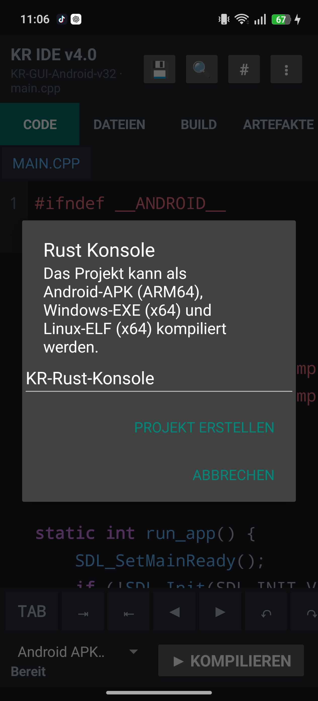
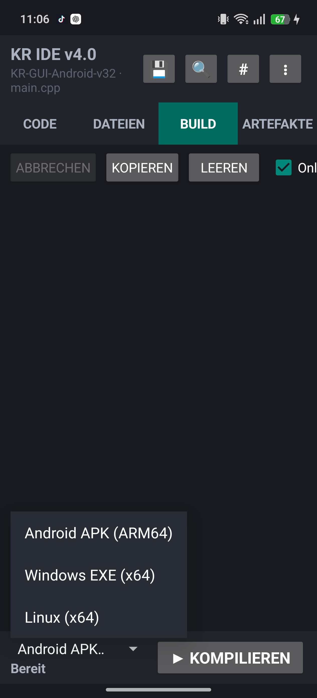
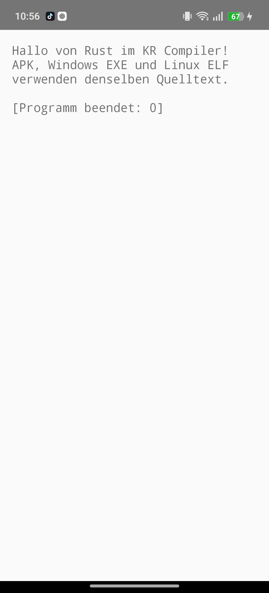
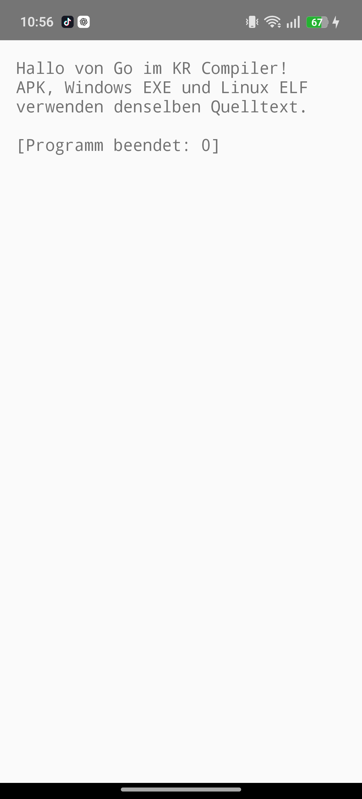

# KR Compiler Android IDE v4.0 Benutzerhandbuch

Dieses Handbuch beschreibt den geprüften Weg von einem neuen Rust- oder Go-Projekt bis zur fertigen Android-APK, Windows-EXE oder Linux-ELF-Datei. Die vier Aufnahmen stammen von den auf einem RMX3853 installierten Beispielprogrammen.

Die ausführliche Fassung steht als [Word-Handbuch](KR_Compiler_Android_Benutzerhandbuch_v4.0_15-10-2026.docx) bereit.

## 1 Projekt anlegen

1. KR Compiler öffnen und über die drei Punkte das Projektmenü aufrufen.
2. **Neues Rust-/Go-Projekt** wählen.
3. **Rust** oder **Go** auswählen.
4. **Konsole** oder **GUI mit SDL3** auswählen.
5. Einen Projektnamen eingeben und bestätigen.

Rust-Projekte enthalten `Cargo.toml` und `src/main.rs`. Go-Projekte enthalten `go.mod` und `main.go`. GUI-Projekte erhalten zusätzlich die Kennzeichnung für den SDL3-Runner.

| Projektmenü | Projekttyp wählen |
|---|---|
|  |  |

| Projektname | Zielsystem |
|---|---|
|  |  |

## 2 Quelltext bearbeiten

Die neue Quelldatei wird direkt im Editor geöffnet. Rust- und Go-Dateien erscheinen in der Dateiansicht und können wie C++-Dateien gespeichert, gesucht und bearbeitet werden. Im Querformat reduziert die IDE die Leistenhöhe automatisch, damit mehr als eine Codezeile sichtbar bleibt.

## 3 Ziel wählen und kompilieren

In der Build-Ansicht stehen drei Ziele bereit:

| Ziel | Ausgabe |
|---|---|
| Android APK ARM64 | installierbare und signierte APK |
| Windows EXE x64 | `programm.exe` |
| Linux Programm x64 | `programm` als ELF-Datei |

Nach der Zielwahl **Kompilieren** antippen. Beim ersten Rust- oder Go-Build richtet die IDE den eingebetteten Compiler ein. Desktop-Builds von Rust können beim ersten Mal länger dauern, weil die passende Standardbibliothek erzeugt wird.

## 4 Artefakt verwenden

Nach **Build fertig** zur Ansicht **Artefakte** wechseln. Android-Dateien lassen sich direkt installieren und starten. Windows- und Linux-Dateien können geteilt oder auf den Zielrechner kopiert werden. Unter Linux muss die Datei gegebenenfalls mit `chmod +x programm` ausführbar gemacht werden.

## 5 Rust Konsole

Die Rust-Konsolenvorlage schreibt eine kurze Erfolgsmeldung und verwendet für alle drei Zielsysteme denselben Rust-Quelltext.

## 6 Go Konsole

Die Go-Konsolenvorlage verwendet ebenfalls einen gemeinsamen Quelltext für APK, EXE und ELF.

## 7 Rust GUI

Die Rust-GUI-Vorlage öffnet über SDL3 eine native Zeichenfläche. Auf Android wird sie durch SDLActivity gestartet; Windows und Linux erhalten eigenständige Desktopprogramme.

## 8 Go GUI

Die Go-GUI-Vorlage bindet den gleichen SDL3-Runner ein und erzeugt auf allen drei Zielen eine grafische Anwendung.

## 9 C++ GUI und vcpkg

Die vorhandene C++-GUI-Funktion bleibt erhalten. Über **Neues GUI-Projekt** entsteht eine SDL3- und Dear-ImGui-Vorlage. Unter **vcpkg-Bibliotheken** werden zusätzliche portable Bibliotheken im `vcpkg.json`-Manifest verwaltet. Android-, Windows- und Linux-Builds verwenden die jeweilige Ziel-Werkzeugkette.

## 10 Fehlerbehebung

| Meldung oder Verhalten | Lösung |
|---|---|
| Compiler wird beim ersten Start eingerichtet | Den Vorgang nicht abbrechen und ausreichend freien Speicher bereitstellen. |
| Rust-Desktop-Build dauert lange | Beim ersten Ziel-Build wird die Rust-Standardbibliothek erzeugt; spätere Builds verwenden den Cache. |
| Go meldet fehlendes CGO | Für GUI-Projekte die v4.0-Vorlage verwenden; sie setzt Compiler und SDL3-Verknüpfung automatisch. |
| Android-Installation wird blockiert | Installation aus KR Compiler in den Android-Einstellungen erlauben. |
| Runner besitzt eine andere Signatur | Das ältere Beispielprogramm **KR C++ Programm** deinstallieren und das neue Artefakt erneut installieren. |
| Linux-Datei startet nicht | Ausführungsrecht setzen und ein x86-64-Linux-System mit glibc verwenden. |

Teststand: KR Compiler Android IDE 4.0.0 auf RMX3853, 15. Oktober 2026.
