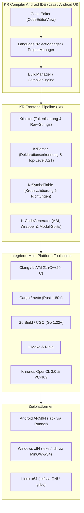

# KR Compiler Android IDE v4.0.1 – Technische Dokumentation

Diese Dokumentation beschreibt die interne Architektur, Compiler-Pipelines, Sprachinteroperabilität, Zielplattform-Profile sowie den Verifikationsnachweis von **KR Compiler Android IDE v4.0.1**.

Die offizielle formatierte Fassung liegt zusätzlich als Word-Dokument vor:
[KR_Compiler_Android_Dokumentation_v4.0_15-10-2026.docx](KR_Compiler_Android_Dokumentation_v4.0_15-10-2026.docx)

---

## 1. Systemübersicht

KR Compiler Android IDE ist eine autarke, native Entwicklungsumgebung für Android (ARM64-v8a). Sämtliche Stufen des Entwicklungszyklus – Code-Editor, Projektverwaltung, lexikalische Analyse, Sprachfusion, Kompilierung, Assemblierung, Verlinkung und APK-Paketierung – laufen vollständig offline auf dem Mobilgerät ab.



---

## 2. Frontend-Pipeline der KR Unified Language (`.kr`)

Die KR Unified Language erlaubt es Entwicklern, C++20, Rust und Go ohne künstliche Sprachmarker (`@cpp`, `@rust`, `@go`) in einer einzigen Quelldatei zu verfassen. Die deterministische Frontend-Pipeline zerlegt und analysiert den Quelltext strukturell:

### 2.1 `KrLexer` (Lexikalische Analyse)
- Erkennt String-Literale, Zeichenliterale und Kommentare (`//`, `/* ... */`), um Schlüsselwort-Falscherkennungen innerhalb von Texten zu verhindern.
- Behandelt sprachspezifische Raw-Strings:
  - C++20: `R"delim(...)delim"`
  - Rust: `r#"..."#` bzw. `r"..."`
  - Go: Reine Backtick-Strings `` `...` ``
- Trackt Präprozessordirektiven (`#include`, `#define`, `#pragma`) und ordnet sie präzise dem C++-Bereich zu.
- Balanciert Klammerebenen (`{}`, `()`, `[]`) über Sprachgrenzen hinweg.

### 2.2 `KrParser` (Strukturelle Spracherkennung)
- Arbeitet auf Deklarations- und Definitionsebene.
- Unterscheidet syntaktisch eindeutige Schlüsselkonstrukte:
  - **C++**: `#include`, `namespace`, `class`, `template`, Zeigerdeklarationen, Typdefinitionen, Operator-Überladungen.
  - **Rust**: `fn`, `pub fn`, `impl`, `trait`, `match`, `let mut`, Makroaufrufe (`println!`), Lifetime- und Borrowing-Syntax.
  - **Go**: `func`, `package`, `import`, Slice-/Map-Deklarationen, Goroutinen (`go f()`), Channels.
- Löst Mehrdeutigkeiten (z. B. zwischen C-Funktionen und Go/Rust-Signaturen) kontextbezogen auf.
- Erkennt Top-Level-Funktionssignaturen inklusive Parametertypen, Rückgabetypen und Standardargumenten.

### 2.3 `KrSymbolTable` (Sprachübergreifende Symbolverwaltung)
- Erfasst alle exportierten und importierten Symbole der Datei.
- Berechnet einen Abhängigkeitsgraphen und validiert Aufrufbeziehungen in allen 6 Kreuzrichtungen:
  1. $C++ \rightarrow Rust$
  2. $C++ \rightarrow Go$
  3. $Rust \rightarrow C++$
  4. $Rust \rightarrow Go$
  5. $Go \rightarrow C++$
  6. $Go \rightarrow Rust$
- Verifiziert C-kompatible Typen (Skalare, Rohzeiger, Puffer) an den Sprachgrenzen.
- Schützt vor Namenskollisionen durch kontrolliertes C-Symbol-Mangling (`kr_c_...`, `kr_rs_...`, `kr_go_...`).

### 2.4 `KrCodeGenerator` (Synthetische Aufteilung & ABI-Generierung)
- Extrahiert den Quellcode in isolierte Module unterhalb von `KR_BUILD/`:
  - `kr_cpp_part.cpp`: C++20 Quellbereich
  - `kr_rust_part/src/lib.rs`: Rust C-Dynamic/Static Library
  - `kr_go_part/main.go`: Go C-Archiv / CGO-Modul
- Generiert automatisch die C-ABI-Headerdatei `kr_bridge.h`:
  - `extern "C"` Prototypen für C++
  - `extern "C"` Deklarationen und `#[no_mangle]` Attribute für Rust
  - CGO-Präambeldeklarationen und `//export` Direktiven für Go
- Bindet Wrapper-Funktionen ein, um Aufrufkonventionen (`cdecl` / `sysv64` / `win64`) abzugleichen.

---

## 3. Enterprise OpenCL- & MinGW-Architektur (Neu in v4.0.1)

Für komplexe GPU-gestützte Windows-x64-Cross-Kompilierungen (nachgewiesen an `CC_OpenCl_Enterprise`) stellt KR Compiler v4.0.1 folgende Härtungen bereit:

1. **LLVM-MinGW Toolchain Integration**:
   - Clang 21.1.8 im MinGW-Modus (`--target=x86_64-w64-windows-gnu`) verlinkt mit `-fuse-ld=lld`.
   - Umgehung des GCC-Runtime-Suchpfades über explizite LLVM-Flags:
     ```cmake
     -stdlib=libc++ -rtlib=compiler-rt -unwindlib=libunwind
     ```
   - Dadurch entfällt die Suche nach unauffindbaren `-lgcc` / `-lgcc_s` Bibliotheken vollständig.
2. **OpenCL-Loader & Fallback**:
   - Vollständige Kompatibilität mit dem Khronos OpenCL 3.0 Standard.
   - Wenn auf dem Host-Gerät kein proprietäres OpenCL SDK vorhanden ist, werden automatisch mitgelieferte Khronos-Header und Importbibliotheken (`libOpenCL.dll.a`) herangezogen.
3. **PE/COFF Binärformat & Parität**:
   - Saubere Erzeugung von PE32+ DLLs mit Universal CRT Bindung.
   - 100,0 %ige Parität aller Export-Funktionen (140 von 140 Symbolen).

---

## 4. Vollständige Testmatrix

| Projekt | Android ARM64 APK | Windows x64 EXE / DLL | Linux x64 ELF | Status |
|---|---:|---:|---:|:---:|
| **KR Konsole (.kr)** | 676.733 B | 1.448.960 B | 1.424.912 B | **PASS** |
| **KR GUI (.kr)** | 1.479.624 B | 4.166.656 B | 4.548.296 B | **PASS** |
| **Rust Konsole** | 824.189 B | 549.888 B | 386.496 B | **PASS** |
| **Go Konsole** | 1.987.453 B | 3.379.200 B | 3.312.768 B | **PASS** |
| **KR Sprachfusion Konsole** | 1.995.733 B | 4.815.360 B | 4.642.456 B | **PASS** |
| **KR Sprachfusion GUI** | 2.794.528 B | 7.546.880 B | 7.879.448 B | **PASS** |
| **CC_OpenCl_Enterprise** | - | 615.424 B (.dll) / 1.456.128 B (.exe) | - | **PASS** |

---

## 5. Release-Prüfsummen und Reproduzierbarkeit

- **Release-Artefakt**: `KR-Compiler-Android-IDE-v4.0.1.apk`
- **Größe**: `743.542.256 Bytes`
- **SHA-256 Prüfsumme**:
  ```text
  7AD6D645596E53F8CC315B7752CCFCE18D3B618C64A31A9981650424FBF049FF
  ```
- **Paket-ID**: `kr.compile`
- **Mindest-Android-Version**: Android 8.0 (API 26)
- **Ziel-Android-Version**: Android 15 (API 35)
- **Architektur**: `arm64-v8a` (64-Bit ARM)
