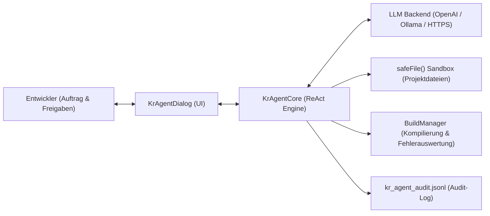

# KR Compiler Android IDE v4.0.3 – Technische Dokumentation

Diese Dokumentation beschreibt die interne Architektur, Compiler-Pipelines, Modul-Auflösung, Sprachinteroperabilität und die Ausführungsmodelle von **KR Compiler Android IDE v4.0.3**.

---

## 1. Systemübersicht & Modulare Architektur

KR Compiler Android IDE v4.0.3 ist eine autarke, native mobile Entwicklungsumgebung für Android (ARM64-v8a). Mit Version 4.0.3 wird die Engine von reinen Single-File-Interoperabilitätsmodellen zu einer **vollständig hierarchischen, modularen Multi-File-Projektarchitektur** erweitert.

```mermaid
flowchart TD
    subgraph Storage ["Projekt-Dateisystem (*.krproject)"]
        CONF["forge.krproject (TOML Parser: KrProjectConfig)"]
        ENTRY["main.kr (Einstiegspunkt)"]
        MODS["app/*.kr, gui/*.kr, research/*.kr, compute/*.kr, ..."]
    end

    subgraph Pipeline ["KR Frontend Modular Pipeline"]
        Scan["Relative Path Normalizer & Modul-Discovery"]
        Lex["KrLexer (Tokenisierung & Raw-Strings)"]
        Parse["KrParser (Deklarationen & Top-Level ASTs)"]
        Sym["KrSymbolTable (Globale Kreuzvalidierung)"]
        Gen["KrCodeGenerator (ABI, kr_bridge.h & Modular Translation Units)"]
    end

    subgraph ArtifactGen ["Codegenerierungs-Schicht"]
        Bridge["kr_bridge.h (Zentraler FFI-Header)"]
        ModCPP["modules/<rel_path>_kr.cpp (Individuelle C++ TUs)"]
        AggRust["kr_rust/src/lib.rs (Rust Crate)"]
        AggGo["kr_go/main.go (Go CGO Module)"]
    end

    subgraph BuildEngine ["CompilerEngine & Toolchains"]
        Clang["Clang++ C++20 (-c modules/*.cpp -o modules/*.o)"]
        Rustc["Rustc / Cargo (libkr_rust.a)"]
        GoTool["Go Build (libkr_go.a via CGO)"]
        LLD["LLD Linker (Cross-Target Finalizer)"]
    end

    subgraph Targets ["Ziel-Binärdateien"]
        APK["Android ARM64 (.apk)"]
        EXE["Windows x64 (.exe / .dll)"]
        ELF["Linux x64 (.elf)"]
    end

    Storage --> Pipeline
    Pipeline --> ArtifactGen
    ArtifactGen --> BuildEngine
    BuildEngine --> Targets
```



---

## 2. Die modulare Frontend-Pipeline

### 2.1 `KrProjectConfig` (Projektkonfigurations-Parser)
- Parst deklarative `*.krproject`-Dateien mit TOML-Semantik.
- Unterstützte Schlüssel:
  - `[project]`: `name`, `version`, `entry`, `description`
  - `[modules]`: `scan_directories` (Liste von Unterverzeichnissen)
  - `[dependencies]`: `packages` (automatische Überführung in `vcpkg.json`)
  - `[build]`: `cpp_standard`, `optimization`

### 2.2 Relativer Modul-Scan & Pfadnormalisierung
- `KrPipeline` relativiert alle Modulpfade gegen das Projektverzeichnis (`projectDir.toURI().relativize(file.toURI()).getPath()`).
- Dies garantiert konsistente, kollisionsfreie Modulbezeichner wie `app/application.kr` oder `compute/cpu_executor.kr`.
- Scannt sowohl die Haupt-Quelldatei als auch alle rekursiv aufgefundenen `.kr`-Dateien in den deklarierten Scan-Verzeichnissen.

### 2.3 Modulare Codegenerierung (`KrCodeGenerator`)
- **`kr_bridge.h`**: Zentraler Schnittstellen-Header, der alle exportierten C++-, Rust- und Go-Funktionssignaturen mit C-ABI deklariert.
- **Modulare C++ Translation Units**:
  - Jede modulare `.kr`-Datei mit C++-Inhalten generiert eine eigene `.cpp`-Datei unter `modules/` (z. B. `modules/app_application_kr.cpp`).
  - Dies verhindert Symbolüberdeckungen und ermöglicht inkrementelle Übersetzung.
- **Konsolidierte Rust- und Go-Module**:
  - Rust-Funktionen aus allen Modulen werden in `kr_rust/src/lib.rs` mit `#[no_mangle] pub extern "C"` zusammengefasst.
  - Go-Funktionen aus allen Modulen werden in `kr_go/main.go` mit `//export` zusammengeführt.

---

## 3. Linker- & Finalizer-Architektur (`CompilerEngine`)

Die Methode `buildKrUnified` in `CompilerEngine.java` orchestriert die parallele Übersetzung aller Komponenten:

1. **Modulare C++ Kompilierung**:
   - Für jedes Modul in `result.cppSources` wird ein Objektfile unter `modules/*.o` erzeugt:
   ```bash
   clang++ -target <triple> -std=c++20 -O3 -I<genDir> -c modules/app_application_kr.cpp -o modules/app_application_kr.o
   ```
2. **Rust- und Go-Build**:
   - Rust-Crate wird als statisches Archiv `libkr_rust.a` gebaut.
   - Go-Package wird via `cgo -buildmode=c-archive` als `libkr_go.a` erzeugt.
3. **Multi-Dependency Manifest (`vcpkg.json`)**:
   - Falls `result.vcpkgDependencies` deklariert sind, generiert der Finalizer ein standardisiertes `vcpkg.json`.
4. **Finaler Linkerschritt (`linkKrUnified`)**:
   - LLD verlinkt alle `modules/*.o`, `kr_cpp.o`, `libkr_rust.a`, `libkr_go.a` sowie plattformspezifische Runtimes (libc++, libunwind, MinGW bzw. glibc).

---

## 4. Zielplattformen & Matrix

| Zielsystem | Triple | Compiler | Linker | Binärformat |
|---|---|---|---|---|
| **Android ARM64** | `aarch64-linux-android28` | Clang++ 21 | LLD (ld.lld) | Standalone APK (`libuser.so` via Runner) |
| **Windows x64** | `x86_64-w64-mingw32` | Clang++ 21 | LLD (lld-link) | Native PE/COFF (`.exe`, `.dll`) |
| **Linux x64** | `x86_64-linux-gnu` | Clang++ 21 | LLD (ld.lld) | Native ELF 64-Bit (`.elf`) |

---

## 5. Autonome KI-Agenten-Architektur (`KrAgentCore` & `KrAgentDialog`)

Version 4.0.3 führt eine vollständig entkoppelte, sandboxed Agenten-Schicht ein, die Entwickler bei der Codierung, Fehlersuche und Kompilierung unterstützt.



### 5.1 ReAct-Schleife & Werkzeugschnittstellen
`KrAgentCore` interagiert mit LLMs über das standardisierte OpenAI Chat Completions Protokoll. Das Modell antwortet in einem streng typisierten JSON-Format mit genau einer Aktion pro Schritt:
- `list`: Verzeichnisinhalte rekursiv erfassen.
- `read`: UTF-8 Quelltext bis 256 KiB einlesen (Binärdateien sind blockiert).
- `write`: Textdateien atomar via temporäre Dateien und `StandardCopyOption.ATOMIC_MOVE` schreiben.
- `build`: Asynchronen Build über `BuildManager.getInstance().startBuild()` anstoßen und Compiler-Logs (bis 9000 Zeichen) zurück an das Modell zur Fehlerbehebung übergeben.
- `done`: Abschlussnachricht an den Nutzer.

### 5.2 Sicherheitsmodell & Sandbox
1. **Pfadisolierung (`safeFile`)**:
   Alle relativen Pfade werden gegen das kanonische Projektverzeichnis aufgelöst. Versuche, aus dem Projekt auszubrechen (`..`, absolute Pfade, Systemdateien), lösen eine sofortige `IOException` aus.
   Geschützte Segmente (`.git`, `.gradle`, `KR_BUILD`, `.kragent`) sind tabu.
2. **Human-in-the-Loop Freigaben**:
   Schreiboperationen und Build-Starts blockieren den Hintergrund-Thread über einen `CountDownLatch`, bis der Entwickler im Hauptthread über einen Bestätigungsdialog mit Vorschau (`Approval`) zustimmt.
3. **Compilerkern-Schutz**:
   Der Agent operiert als optionale Schicht und hat keinerlei Schreibzugriff auf IDE-Systemdateien (`CompilerEngine`, `KrPipeline`, Toolchain-Sysroots).
4. **Audit-Trail**:
   Alle Aktionen, Zeitstempel und Modellmeldungen werden persistent in `kr_agent_audit.jsonl` protokolliert.
