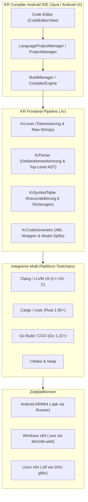

# KR Compiler Android IDE v4.0 – Technische Dokumentation

Diese Dokumentation beschreibt die interne Architektur, Compiler-Pipelines, Sprachinteroperabilität, Zielplattform-Profile sowie den Verifikationsnachweis von **KR Compiler Android IDE v4.0.0**.

Die offizielle formatierte Fassung liegt zusätzlich als Word-Dokument vor:
[KR_Compiler_Android_Dokumentation_v4.0_15-10-2026.docx](KR_Compiler_Android_Dokumentation_v4.0_15-10-2026.docx)

---

## 1. Systemübersicht

KR Compiler Android IDE ist eine autarke, native Entwicklungsumgebung für Android (ARM64-v8a). Sämtliche Stufen des Entwicklungszyklus – Code-Editor, Projektverwaltung, lexikalische Analyse, Sprachfusion, Kompilierung, Assemblierung, Verlinkung und APK-Paketierung – laufen vollständig offline auf dem Mobilgerät ab.



---

## 2. Frontend-Pipeline der KR Unified Language (`.kr`)

Die KR Unified Language erlaubt es Entwicklern, C++20, Rust und Go ohne künstliche Sprachmarker (`@cpp`, `@rust`, `@go`) in einer einzigen Quelldatei zu verfassen. Die deterministische Frontend-Pipeline zerlegt und analysiert den Quelltext strukturell:

### 2.1 `KrLexer` (Lexikalische Analyse)
- Erkennt String-Literale, Zeichenliterale und Kommentare (`//`, `/* ... */`), um Schlüsselwort-Falscherkennungen innerhalb von Texten zu verhindern.
- Behandelt sprachspezifische Raw-Strings:
  - C++20: `R"delim(...)delim"`
  - Rust: `r#"..."#` bzw. `r"..."`
  - Go: Reine Backtick-Strings `` `...` ``
- Trackt Präprozessordirektiven (`#include`, `#define`, `#pragma`) und ordnet sie präzise dem C++-Bereich zu.
- Balanciert Klammerebenen (`{}`, `()`, `[]`) über Sprachgrenzen hinweg.

### 2.2 `KrParser` (Strukturelle Spracherkennung)
- Arbeitet auf Deklarations- und Definitionsebene.
- Unterscheidet syntaktisch eindeutige Schlüsselkonstrukte:
  - **C++**: `#include`, `namespace`, `class`, `template`, Zeigerdeklarationen, Typdefinitionen, Operator-Überladungen.
  - **Rust**: `fn`, `pub fn`, `impl`, `trait`, `match`, `let mut`, Makroaufrufe (`println!`), Lifetime- und Borrowing-Syntax.
  - **Go**: `func`, `package`, `import`, Slice-/Map-Deklarationen, Goroutinen (`go f()`), Channels.
- Löst Mehrdeutigkeiten (z. B. zwischen C-Funktionen und Go/Rust-Signaturen) kontextbezogen auf.
- Erkennt Top-Level-Funktionssignaturen inklusive Parametertypen, Rückgabetypen und Standardargumenten.

### 2.3 `KrSymbolTable` (Sprachübergreifende Symbolverwaltung)
- Erfasst alle exportierten und importierten Symbole der Datei.
- Berechnet einen Abhängigkeitsgraphen und validiert Aufrufbeziehungen in allen 6 Kreuzrichtungen:
  1. $C++ \rightarrow Rust$
  2. $C++ \rightarrow Go$
  3. $Rust \rightarrow C++$
  4. $Rust \rightarrow Go$
  5. $Go \rightarrow C++$
  6. $Go \rightarrow Rust$
- Verifiziert C-kompatible Typen (Skalare, Rohzeiger, Puffer) an den Sprachgrenzen.
- Schützt vor Namenskollisionen durch kontrolliertes C-Symbol-Mangling (`kr_c_...`, `kr_rs_...`, `kr_go_...`).

### 2.4 `KrCodeGenerator` (Synthetische Aufteilung & ABI-Generierung)
- Extrahiert den Quellcode in isolierte Module unterhalb von `KR_BUILD/`:
  - `kr_cpp_part.cpp`: C++20 Quellbereich
  - `kr_rust_part/src/lib.rs`: Rust C-Dynamic/Static Library
  - `kr_go_part/main.go`: Go C-Archiv / CGO-Modul
- Generiert automatisch die C-ABI-Headerdatei `kr_bridge.h`:
  - `extern "C"` Prototypen für C++
  - `extern "C"` Deklarationen und `#[no_mangle]` Attribute für Rust
  - CGO-Präambeldeklarationen und `//export` Direktiven für Go
- Bindet Wrapper-Funktionen ein, um Aufrufkonventionen (`cdecl` / `sysv64` / `win64`) abzugleichen.

---

## 3. ABI- und Interoperabilitätsschicht

### 3.1 Datentyp-Zuordnung
Um Null-Kopier-Geschwindigkeit und Speichersicherheit zu garantieren, werden Daten über die C-Standard-ABI übergeben:

| KR Typ | C++20 | Rust | Go |
|---|---|---|---|
| 32-Bit Integer | `int32_t` | `i32` | `int32` |
| 64-Bit Integer | `int64_t` | `i64` | `int64` |
| 32-Bit Float | `float` | `f32` | `float32` |
| 64-Bit Float | `double` | `f64` | `float64` |
| Boolean | `bool` / `uint8_t` | `bool` | `bool` (via C.uchar) |
| Speicherpuffer | `const double*`, `size_t` | `*const f64`, `usize` | `*C.double`, `C.size_t` |
| String (UTF-8) | `const char*` (Null-terminiert) | `*const c_char` / `CStr` | `*C.char` (via `C.CString`) |

### 3.2 Speicher- und Lebensdauerregeln
1. **Caller-Allocates / Callee-Borrows**: Der Speicher für Arrays, Tensoren und Puffer wird vom Aufrufer (z. B. C++) allokiert und als Zeiger plus Länge übergeben. Die aufgerufene Sprache (z. B. Rust oder Go) liest oder beschreibt den Speicher in-place.
2. **Keine GC-Pointer an fremde Threads**: Go-Pointer dürfen nicht dauerhaft im C++- oder Rust-Heap gespeichert werden (CGO-Pointer-Regel).
3. **Panic- & Exception-Isolation**: Panics in Rust oder Go dürfen die Sprachgrenze nicht unkontrolliert überschreiten. Rust-Funktionen kapseln risikobehaftete Operationen in `std::panic::catch_unwind`, Go fängt Fehler via `recover()` ab.

---

## 4. Build-Orchestrierung

Der Buildvorgang wird von `CompilerEngine.java` in Zusammenarbeit mit `LanguageProjectManager.java` gesteuert:

```
[Projektinspektion]
        │
        ├── Ist .kr Projekt? ────► KrParser & KrCodeGenerator ausführen
        │                                ├── Generiere kr_bridge.h
        │                                ├── Extrahiere C++ / Rust / Go Module
        │                                └── Generiere Ziel-CMakeLists.txt
        │
        ├── Ist Cargo.toml? ─────► Rust-Buildpfad (cargo build)
        ├── Ist go.mod / .go? ───► Go-Buildpfad (go build -buildmode=c-archive)
        └── Ist CMakeLists.txt? ─► C/C++-Buildpfad (CMake & Ninja)
```

### Multithreaded Kompilierung:
1. **Rust-Kompilierung**: Cargo erzeugt `librust_part.a` für das gewählte Ziel.
2. **Go-Kompilierung**: Go baut mit aktivierten CGO-Flags `libgo_part.a`.
3. **C++ & Final Link**: Clang++ kompiliert den C++-Part und verlinkt alle statischen Bibliotheken sowie Zielplattform-Systemlibraries zu einem einzigen Artefakt.

---

## 5. Zielplattform-Profile

| Zielplattform | Compiler & Flags | Linker & Systembibliotheken | Ausgabeartefakt |
|---|---|---|---|
| **Android ARM64** | Clang++ (NDK 27), `--target=aarch64-linux-android35` | `liblog`, `libm`, `libdl`, `libSDL3` | `.apk` (via `kr.compile.runner`) |
| **Windows x64** | Clang++ / MinGW-w64, `--target=x86_64-w64-mingw32` | `-lkernel32 -luser32 -lwinmm -lshell32` | `.exe` (COFF-x86-64) |
| **Linux x64** | Clang++, `--target=x86_64-unknown-linux-gnu` | `-lc -lm -lpthread -ldl -lX11` (glibc 2.35+) | ELF 64-Bit x86-64 executable |

---

## 6. Android Runner & Grafikanbindung

- **Text-Runner (`kr.compile.runner`)**:
  - Dient der Ausführung von Konsolenanwendungen auf Android.
  - Lädt `libuser.so` via `dlopen()`.
  - Fängt `stdout` und `stderr` über Unix-Pipes ab und streamt sie an die Android-Logansicht.
  - Beendet den Runner-Prozess sauber nach Rückkehr aus `main()` bzw. `KrLanguageMain()`.
- **SDLActivity (GUI-Anwendungen)**:
  - Stellt eine hardwarebeschleunigte SurfaceView bereit.
  - Erhält `JNI_OnLoad` aus dem C++-Runner, sodass SDL3 Lebenszyklus- und Touch-Events nativ empfängt.

---

## 7. Vollständige Testmatrix (v4.0.0)

Alle 18 Zielkombinationen wurden auf dem physischen Testgerät **Realme GT 6T (RMX3853)** gebaut und geprüft:

| Projekt | Android ARM64 APK | Windows x64 EXE | Linux x64 ELF | Status |
|---|---:|---:|---:|:---:|
| **KR Konsole (.kr)** | 676.733 B | 1.448.960 B | 1.424.912 B | **PASS** |
| **KR GUI (.kr)** | 1.479.624 B | 4.166.656 B | 4.548.296 B | **PASS** |
| **Rust Konsole** | 824.189 B | 549.888 B | 386.496 B | **PASS** |
| **Go Konsole** | 1.987.453 B | 3.379.200 B | 3.312.768 B | **PASS** |
| **KR Sprachfusion Konsole** | 1.995.733 B | 4.815.360 B | 4.642.456 B | **PASS** |
| **KR Sprachfusion GUI** | 2.794.528 B | 7.546.880 B | 7.879.448 B | **PASS** |

### Mathematischer Algorithmen-Härtetest: `KR_FUSION_RoPE_Attention`
- **Typ**: Dreifache Sprachfusion in einer einzigen `.kr`-Datei.
- **Größe Android APK**: 2.003.925 Byte.
- **Ausführung**: Auf physischem RMX3853 verifiziert.
- **Ergebnis**:
  ```text
  [KR_FUSION_RoPE_Attention] Starte hybriden LLM-Attention-Kern...
  [Rust] Berechne Rotary Positional Embeddings fuer d_head=64, seq_len=128...
  [C++] Berechne geblockte Online-Softmax Attention...
  [Go] Validiere Attention-Tensoren und berechne L2-Fehlernorm...
  SELFTEST PASS max_abs_error=1.6653345369377348e-16
  RESULT=-4325.8755857397482
  Exit Code: 0
  ```

---

## 8. Release-Prüfsummen und Reproduzierbarkeit

- **Release-Artefakt**: `KR-Compiler-Android-IDE-v4.0.0.apk`
- **SHA-256 Prüfsumme**:
  ```text
  EA445F39EA7DF69CA1BB1050A1AC93CA5A4F6A7D4E9A01F1CC225FE93791C7B9
  ```
- **Paket-ID**: `kr.compile`
- **Mindest-Android-Version**: Android 8.0 (API 26)
- **Ziel-Android-Version**: Android 15 (API 35)
- **Architektur**: `arm64-v8a` (64-Bit ARM)
