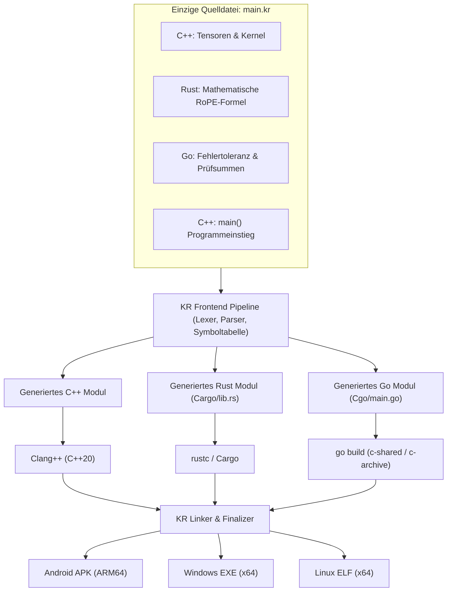
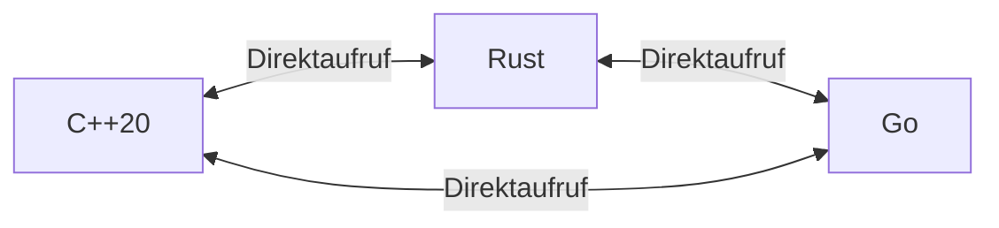

# KR Unified Language (.kr) – Entwickler-Handbuch & Sprachfusions-Leitfaden

> Die **KR Unified Language (`.kr`)** ermöglicht es, **C++20, Rust und Go** innerhalb einer einzigen Quelldatei beliebig miteinander zu kombinieren. Es werden **keine künstlichen Sprachblöcke oder Marker** wie `@cpp`, `@rust`, `@go` oder `language="..."` benötigt. Der KR-Compiler analysiert den Quelltext strukturell, teilt ihn in Sprachsegmente auf, generiert automatisch eine C-kompatible ABI-Brücke und erzeugt ein einzelnes, hochoptimiertes ausführbares Programm für Android (ARM64), Windows (x64) und Linux (x64).

---

## 1. Grundprinzip: Wie funktioniert die Sprachfusion?

In einer `.kr`-Datei schreibt der Entwickler Code einfach in der Syntax der gewünschten Sprache. Der Compiler erkennt den Sprachwechsel anhand syntaktischer Konstrukte auf Deklarations- und Definitionsebene:

- **C++20-Bereiche**: `#include`, Klassen, Templates, Operatoren, Namespaces und reguläre C/C++-Funktionsdefinitionen.
- **Rust-Bereiche**: `fn`, `pub fn`, `let`, `mut`, `match`, `impl`, `trait`, Rust-Makros (`println!`) und Rust-Typen (`i32`, `f64`, etc.).
- **Go-Bereiche**: `func`, `package`, `import`, Go-Typen (`int32`, `float64`), Go-Routinen und Channels.



---

## 2. Die Rollenverteilung: Welche Sprache wofür?

Ein erfahrener Entwickler nutzt die Stärken jeder Sprache gezielt aus:

| Sprache | Idealer Einsatzbereich in `.kr` | Stärken |
|---|---|---|
| **C++20** | Tensoren, Vektoren, Speicherpuffer, SDL3-Grafik, Pointerarithmetik | Maximale Cache-Lokalität, SIMD/Auto-Vektorisierung, RAII |
| **Rust** | Mathematische Kernalgorithmen, Validierung, Zustandsmaschinen | Mathematische Korrektheit, Speichersicherheit, keine Data-Races |
| **Go** | I/O-Orchestrierung, Nebenläufigkeit, Logging, Schwellenwert-Prüfung | Schnelle Concurrency, robuste Standardbibliothek, einfache Syntax |

---

## 3. Kreuzaufrufe (Cross-Language Calls)

Funktionen können sich **über alle Sprachgrenzen hinweg** in allen 6 Richtungen direkt aufrufen:



### Die 3 goldenen Regeln für Funktionsaufrufe:

1. **Globale Eindeutigkeit von Funktionsnamen**:
   Zwei Funktionen in unterschiedlichen Sprachen dürfen nicht denselben Namen tragen.
   - *Richtig*: `cpp_calculate()`, `rust_verify()`, `go_notify()`
   - *Falsch*: `calculate()` in C++ und gleichzeitig `calculate()` in Rust definiert (führt zur Symbolkollision).

2. **C-kompatible Parameter- und Rückgabetypen verwenden**:
   Alle Typen, die Sprachgrenzen überschreiten, müssen im gemeinsamen KR-Typsystem darstellbar sein (siehe Abschnitt 4).

3. **Keine manuellen FFI-Definitionen schreiben**:
   Du musst **kein** `extern "C"`, kein `#[no_mangle]` und kein `//export` schreiben. Der KR-Compiler erkennt anhand der Aufrufbeziehungen selbst, welche Funktionen exportiert werden müssen, und generiert die passenden Wrapper automatisch.

---

## 4. Das gemeinsame Typsystem & ABI-Kompatibilität

Damit Werte verlustfrei und ohne Abstürze zwischen C++, Rust und Go fließen, werden alle sprachübergreifenden Typen auf eine stabile C-kompatible ABI abgebildet:

### 4.1 Skalare Typen-Matrix

| Datentyp | C++20 | Rust | Go | ABI-Repräsentation |
|---|---|---|---|---|
| **Boolean** | `bool` | `bool` | `bool` | `uint8_t` (0 oder 1) |
| **8-Bit Integer (signed)** | `int8_t` / `char` | `i8` | `int8` | `int8_t` |
| **8-Bit Integer (unsigned)**| `uint8_t` / `unsigned char` | `u8` | `uint8` | `uint8_t` |
| **16-Bit Integer (signed)** | `int16_t` / `short` | `i16` | `int16` | `int16_t` |
| **16-Bit Integer (unsigned)**| `uint16_t` | `u16` | `uint16` | `uint16_t` |
| **32-Bit Integer (signed)** | `int32_t` / `int` | `i32` | `int32` | `int32_t` |
| **32-Bit Integer (unsigned)**| `uint32_t` / `unsigned int` | `u32` | `uint32` | `uint32_t` |
| **64-Bit Integer (signed)** | `int64_t` / `long long` | `i64` | `int64` | `int64_t` |
| **64-Bit Integer (unsigned)**| `uint64_t` | `u64` | `uint64` | `uint64_t` |
| **32-Bit Float** | `float` | `f32` | `float32` | `float` (IEEE 754) |
| **64-Bit Float** | `double` | `f64` | `float64` | `double` (IEEE 754) |
| **Kein Rückgabewert** | `void` | `()` (oder weglassen) | (weglassen) | `void` |

Verwende in C++ am besten die Standard-Typen aus `<cstdint>` (`int32_t`, `uint64_t`, `double`). Das garantiert auf allen 3 Zielplattformen (Android ARM64, Windows x64, Linux x64) exakt übereinstimmende Bitbreiten.

---

### 4.2 Zeiger, Arrays und Speicherverwaltung (Ownership)

Wenn große Datenmengen (z. B. Audio-Puffer, Tensoren oder Bildmatrizen) verarbeitet werden, übergibt man Zeiger (`*const T` bzw. `const T*`). Dabei gilt die verbindliche **Ownership-Regel**:

**Wer allokiert, der gibt frei!**
- Wenn C++ einen `std::vector<double>` allokiert, bleibt der Speicher im Besitz von C++. Rust und Go dürfen lesend (`const double*`) oder inplace modifizierend (`double*`) darauf zugreifen, dürfen den Speicher aber **niemals** eigenständig freigeben (kein `free()` in Go/C, kein `drop` in Rust).
- Go-Garbage-Collector-Zeiger dürfen **nicht** an C++ übergeben werden, um dort dauerhaft in globalen Strukturen gespeichert zu werden, da der Go-GC Objekte verschieben oder freigeben kann.
- C++-Klassen mit nicht-trivialen Destruktoren (z. B. `std::string`, `std::vector`) dürfen **nicht by-value** über Sprachgrenzen gereicht werden. Stattdessen übergibt man den Datenzeiger (`vec.data()`) und die Länge (`vec.size()`).

---

## 5. Vollständiges Praxisbeispiel: RoPE Attention

Dieses Beispiel demonstriert eine rechenintensive Sprachfusion aus der Praxis:
- **C++**: Verwaltet die 3D-Tensoren und den hochoptimierten Attention-Kernel.
- **Rust**: Berechnet die RoPE-Rotationsfrequenzen (`base.powf(...)`).
- **Go**: Führt die numerische Fehlerakzeptanz- und Schwellenwertprüfung durch.

```cpp
#include <iostream>
#include <vector>
#include <cmath>
#include <cstdint>

// ---------------------------------------------------------------------------
// 1. C++ Bereich: Tensor-Datenstrukturen
// ---------------------------------------------------------------------------
struct Tensor {
    std::size_t size;
    std::vector<double> data;
    explicit Tensor(std::size_t n) : size(n), data(n, 0.0) {}
};

// C++ ruft die unten definierte Rust-Funktion 'rust_rope_frequency' auf.
// Es ist KEINE manuelle Header-Deklaration nötig!
void apply_rope_to_tensor(Tensor& t, double base) {
    for (std::size_t i = 0; i < t.size; ++i) {
        double freq = rust_rope_frequency(static_cast<int32_t>(i), static_cast<int32_t>(t.size), base);
        t.data[i] *= std::cos(freq);
    }
}

// ---------------------------------------------------------------------------
// 2. Rust Bereich: Reine mathematische Formel
// ---------------------------------------------------------------------------
fn rust_rope_frequency(index: i32, width: i32, base: f64) -> f64 {
    base.powf(-2.0 * (index as f64) / (width as f64))
}

// ---------------------------------------------------------------------------
// 3. Go Bereich: Validierung & Logging
// ---------------------------------------------------------------------------
func go_verify_result(value float64, threshold float64) bool {
    isValid := value >= 0.0 && value <= threshold
    if isValid {
        println("Go: Validierung erfolgreich fuer Wert =", value)
    } else {
        println("Go: FEHLER - Schwellenwert ueberschritten!")
    }
    return isValid
}

// ---------------------------------------------------------------------------
// 4. Gemeinsamer Einstiegspunkt (C++)
// ---------------------------------------------------------------------------
int main() {
    std::cout << "=== KR Unified Language: RoPE Attention ===" << std::endl;
    Tensor q(8);
    for (std::size_t i = 0; i < q.size; ++i) q.data[i] = 1.0;

    apply_rope_to_tensor(q, 10000.0);

    // C++ ruft die Go-Validierungsfunktion auf:
    bool ok = go_verify_result(q.data[0], 1.5);
    std::cout << "Ergebnis-Status: " << (ok ? "OK" : "FEHLER") << std::endl;
    return ok ? 0 : 1;
}
```

---

## 6. Häufige Fehlerquellen & Fallstricke (Troubleshooting)

### 1. `use of undeclared identifier '...'`
- **Ursache**: Der Name einer Funktion wurde in der aufrufenden Sprache falsch geschrieben, oder eine der beteiligten Funktionen hat inkompatible Typen (z. B. ein C++-Objekt by-value übergeben).
- **Lösung**: Überprüfe die Schreibweise und stelle sicher, dass Parameter als primitive Typen (`int32_t`, `double`, Rohzeiger) übergeben werden.

### 2. Mehrfache `main()`-Funktionen
- **Ursache**: In Go wurde `func main() {}` geschrieben, während in C++ bereits `int main()` existiert.
- **Regel**: **Nur ein einziger Programmeinstieg pro `.kr`-Datei!** Wenn C++ `int main()` hat, schreibe in Go **kein** `func main()`. Der KR-Compiler erzeugt für Go und Rust im Hintergrund automatisch die nötigen Modul-Einstiege.

### 3. C++-Exceptions über FFI-Grenzen
- **Ursache**: Eine C++-Funktion wirft eine `std::exception`, während sie von Rust oder Go aus aufgerufen wurde.
- **Regel**: C++-Exceptions können nicht über C-ABI-Grenzen geworfen werden (führt zu `std::terminate`). Fange Exceptions innerhalb der C++-Funktion mit `try/catch` ab und gib stattdessen einen Fehlercode (`int32_t` oder `bool`) an Rust/Go zurück.

### 4. Panics in Rust
- **Ursache**: Ein `panic!` in Rust bricht das gesamte Programm ab.
- **Regel**: Verwende in Rust-Bereichen, die von C++ oder Go aufgerufen werden, defensive Prüfungen und gib Fehlerwerte zurück, statt `panic!` oder `.unwrap()` aufzurufen.

---

## 7. Zusammenfassung: Checkliste für den Entwickler

- [x] **Sprachwechsel**: Schreibe Code einfach in C++, Rust oder Go.
- [x] **Dateiendung**: Speichere das Projekt als `main.kr`.
- [x] **Typen**: Verwende feste Skalartypen (`int32_t`/`i32`/`int32`, `double`/`f64`/`float64`).
- [x] **Pointer**: Übergib Puffer als Rohzeiger (`const double*`, `len: usize`).
- [x] **Einstiegspunkt**: Definiere genau ein `main()` (typischerweise in C++).
- [x] **Build**: Klicke in der KR Compiler Android IDE auf **Kompilieren** – die IDE baut automatisch für deine Zielplattform (Android ARM64, Windows x64 oder Linux x64).
