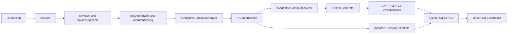

# KR Compiler IDE – vollständige Projektdokumentation

**Dokumentationsstand:** KR Compiler IDE 4.2.1

**Gültigkeit:** Android ARM64, Windows x64 und Linux x64

**Repository:** <https://github.com/kruemmel-python/KR-Compiler>

**Lizenz:** GPL-3.0; Lizenzen eingebetteter Komponenten siehe
[`THIRD_PARTY_NOTICES.md`](../THIRD_PARTY_NOTICES.md)

Diese Datei beschreibt den aktuellen, im Repository vorhandenen Stand. Sie ist
die zentrale technische und funktionale Dokumentation des Gesamtprojekts. Alte
Release-Berichte sind kein Bestandteil dieser Dokumentation; frühere
Binärstände bleiben über GitHub Releases nachvollziehbar.

## 1. Zweck und Produktumfang

KR Compiler IDE ist eine portable Entwicklungsumgebung und Compiler-Pipeline.
Sie bearbeitet und baut:

- KR Unified Language (`.kr`) mit C++20-, Rust- und Go-Sprachbereichen,
- klassische C- und C++-Projekte,
- CMake-Projekte,
- Rust-Projekte mit Cargo,
- Go-Projekte,
- SDL3-/GUI-Projekte und ausgewählte vcpkg-Abhängigkeiten.

Die IDE kann aus einem Projekt Android-ARM64-, Windows-x64- oder Linux-x64-
Artefakte erzeugen. Veröffentlichte portable Pakete enthalten Java-Laufzeit,
Compiler, Linker, Buildsysteme, Ziel-Sysroots und die KR-Laufzeit. Anwender
müssen für den normalen Betrieb kein zusätzliches SDK installieren oder
herunterladen.

Eine wichtige Einschränkung gilt für GPU-Berechnung: Die OpenCL-Schnittstelle,
der ICD-Loader und CC_OpenCL werden mitgeliefert. Der herstellerspezifische
Grafiktreiber gehört jedoch zum Betriebssystem beziehungsweise zum Gerät und
kann aus technischen und lizenzrechtlichen Gründen nicht Teil der IDE sein.

## 2. Aktuelle Version und Plattformen

| Komponente | Stand |
|---|---|
| Produktversion | 4.2.1 |
| Android-Anwendung | `kr.compile`, `minSdk 26`, ARM64-Ziel |
| Android Build-SDK | API 35; NDK 27.0.12077973 für den APK-Quell-Build |
| Windows-Distribution | Windows 10/11 x64 |
| Linux-Distribution | x86-64, Basis Ubuntu 22.04 oder neuer |
| Verifizierte Linux-Umgebung | Ubuntu x64, einschließlich Ubuntu 24.04/WSL2 |
| Praktischer Plattformtest | Android und Ubuntu vom Projektinhaber getestet und funktionsfähig bestätigt |
| Desktop-IDE | Java/Swing |
| Android-IDE | native Android-Oberfläche in Java |
| C++ | C++20 als Standard |
| Rust-Projektstandard | Edition 2024 |
| Go-Projektstandard | Go 1.24 in der KR-Konfiguration |

Android und Ubuntu wurden praktisch getestet und funktionieren. Die Linux-
Baseline bleibt Ubuntu 22.04 oder neuer auf x86-64; historische oder zukünftige
Distributionen können wegen abweichender Kernel-, glibc-, Displayserver- und
Grafiktreiberstände außerhalb dieser unterstützten Basis liegen.

## 3. Auslieferungsmodell und Portabilität

Das Projekt unterscheidet zwei Situationen:

1. **Benutzung einer veröffentlichten Distribution:** Alle Compiler- und
   SDK-Bestandteile liegen im Paket. Es erfolgt kein notwendiger Download eines
   JDK, Android SDK, NDK, Rust-, Go- oder C++-Compilers.
2. **Neuaufbau der Distribution aus dem Git-Quellbaum:** Maintainer benötigen
   einmalig die in den Buildabschnitten genannten Werkzeuge oder führen die
   bereitgestellten Provisionierungsprogramme aus. Große Toolchains werden
   bewusst nicht im Git-Verlauf gespeichert.

Die Plattformpakete sind voneinander unabhängig:

- Die Android-App entpackt ihre Toolchain in den privaten App-Speicher.
- Die Windows-IDE verwendet Laufzeit und Toolchain relativ zu ihrem eigenen
  Installationsordner.
- Die Linux-IDE akzeptiert ausschließlich Werkzeuge unter `linux/toolchain`.
  Ein stiller Rückfall auf `/usr/bin` oder ein System-JDK ist nicht vorgesehen.

Build- und Download-Caches der Maintainer-Skripte können vollständig im
Projektlaufwerk liegen. Die Linux-Provisionierung verwendet zum Beispiel
`linux/.linux-toolchain-cache`.

## 4. Repository-Struktur

```text
KR-Compiler/
├── android/                    Android-IDE, APK-Runner und Toolchain-Integration
│   ├── app/                    Hauptanwendung
│   ├── runner/                 Vorlage für erzeugte Android-Programme
│   ├── CC_OpenCl_Enterprise-main/
│   │                           eingebettete CC_OpenCL-Quellen und API-Dokumente
│   ├── scripts/                Build-, Signatur- und Toolchain-Skripte
│   └── tests/                  Compute-, Abhängigkeits- und GUI-Tests
├── windows/                    eigenständige Windows-Desktop-IDE
│   ├── src/                    Java-Quellcode
│   ├── components/cc-opencl/   native Compute-Komponente
│   └── dist/                   IDE-JAR
├── linux/                      eigenständige Linux-Desktop-IDE
│   ├── src/                    Java-Quellcode
│   ├── components/cc-opencl/   native Compute-Komponente
│   ├── scripts/                Provisionierung und Verifikation
│   └── dist/                   IDE-JAR
├── KR_AUTO_COMPUTE_TEST/       aktuelles End-to-End-Beispiel
├── tests/                      plattformübergreifende Testwerkzeuge
├── docs/                       aktuelle Dokumentation
├── README.md                   kompakter Projekteinstieg
└── RELEASE_NOTES.md            Hinweise ausschließlich zum aktuellen Release
```

Der Kern der KR-Pipeline ist für alle drei IDEs vorhanden. Die Pakete
`android/app/src/main/java/kr/compile`, `windows/src/kr/compile` und
`linux/src/kr/compile` enthalten die plattformspezifischen Kopien des
Frontends, des Codegenerators und der Buildsteuerung. Die jeweiligen
Oberflächen liegen zusätzlich in Android `MainActivity` beziehungsweise den
Desktop-Paketen `kr.compile.windows` und `kr.compile.linux`.

## 5. Bedienoberfläche

### 5.1 Gemeinsame Arbeitsbereiche

Die IDE gliedert sich in vier Hauptansichten:

- **CODE:** Editor mit mehreren Dateien, Syntaxhervorhebung, Zeilenstatus,
  Rückgängig/Wiederholen und Speichern.
- **DATEIEN:** Projektbaum sowie Anlegen, Umbenennen und Löschen von Dateien
  und Ordnern.
- **BUILD:** Auswahl des Zielsystems, Buildprotokoll, Start und Abbruch.
- **ARTEFAKTE:** erzeugte Dateien und Protokolle aus `KR_BUILD`.

Der integrierte **AGENT** ist ein zusätzlicher Dialog und kein Bestandteil der
Compilersemantik. Adaptive Compute kann über **Adaptive Compute analysieren**
untersucht werden.

### 5.2 Android-Projektzugriff

Die Android-App unterstützt zwei Projektquellen:

- einen durch Androids Storage Access Framework freigegebenen Ordner;
- einen echten lokalen Ordner, etwa einen von der IDE importierten Inhalt.

Bei einem Storage-Access-Framework-Projekt wird der Baum vor dem Build in
einen privaten Arbeitsordner importiert. Das Ergebnis wird anschließend in den
Unterordner `KR_BUILD` des freigegebenen Projektordners exportiert. Für die
reine Analyse ist ebenfalls ein gültiger lokaler Spiegel notwendig; die App
erzeugt ihn bei einem SAF-Projekt temporär selbst.

### 5.3 Desktop-Projektzugriff

Windows und Linux arbeiten direkt mit einem lokalen Projektordner. Desktop-
Artefakte können aus der Artefaktansicht gestartet beziehungsweise im
Dateimanager angezeigt werden.

## 6. Unterstützte Projekttypen und Erkennung

Die Buildsteuerung verwendet folgende Priorität:

1. mindestens eine `.kr`-Datei: KR-Unified-Pipeline;
2. `Cargo.toml`: Rust/Cargo;
3. `go.mod` oder passende Go-Quellen ohne vorrangiges CMake-Projekt: Go;
4. `CMakeLists.txt`: CMake/Ninja;
5. andernfalls direkter Build vorhandener `.c`, `.cc`, `.cpp` und `.cxx`.

`KR_BUILD`, `.git`, `.gradle` und typische Buildverzeichnisse werden beim
Quellscan ausgeschlossen. In CMake-Projekten sammelt die IDE ausführbare und
Shared-Library-Ziele, filtert klar plattformfremde Ziele und wählt bei mehreren
Kandidaten ein wahrscheinliches Hauptprogramm. Mit `kr-android-target.txt`
kann ein CMake-Ziel ausdrücklich gewählt werden.

Für Android wird ein ausführbares CMake-Ziel intern als Shared Library gebaut
und in eine Runner-APK eingesetzt. Ressourcen aus dem Projekt werden in die
APK übernommen. Für Windows entsteht üblicherweise eine `.exe`, für Linux ein
ELF-Programm.

## 7. KR Unified Language

Eine `.kr`-Datei darf C++-, Rust- und Go-Bereiche ohne künstliche Marker wie
`@cpp`, `@rust` oder `@go` enthalten. Lexer und Parser erkennen die Sprache
strukturell. Funktionen werden in einer gemeinsamen Symboltabelle registriert,
Aufrufe werden projektweit aufgelöst und bei Sprachgrenzen durch eine
C-kompatible ABI verbunden.

### 7.1 Grundregeln

- Funktionsnamen müssen projektweit eindeutig sein.
- Über Sprachgrenzen sollten ABI-stabile skalare Typen und Rohzeiger verwendet
  werden.
- Es darf nur einen Programmeinstieg geben.
- C++-Objekte mit nicht trivialem Layout werden nicht by-value über eine
  Sprachgrenze gegeben.
- Der Besitzer eines Puffers bleibt für dessen Lebensdauer und Freigabe
  verantwortlich.
- Exceptions oder Panics dürfen eine C-ABI-Grenze nicht unkontrolliert
  überschreiten.

Die vollständige Typmatrix, Sprachbeispiele und Regeln stehen im
[`KR Unified Language Guide`](KR_UNIFIED_LANGUAGE_GUIDE.md).

### 7.2 Mehrdatei-Projekte

Alle `.kr`-Dateien unterhalb der Projektwurzel werden rekursiv gefunden. Bei
mehreren Quelldateien erzeugt der Codegenerator modulare C++-Translation-Units
sowie je ein zusammengeführtes Rust-Crate und Go-Modul. Der zentrale Header
`kr_bridge.h` enthält die benötigten sprachübergreifenden Deklarationen.

## 8. Projektdatei `.krproject`

Die Konfiguration ist TOML-ähnlich. Nicht gesetzte Werte erhalten sichere
Standardwerte.

```toml
[project]
name = "MEIN_PROJEKT"
version = "1.0.0"
entry = "main.kr"
target_type = "console"

[modules]
scan_directories = ["src", "compute"]

[dependencies]
packages = ["fmt", "nlohmann-json"]

[build]
cpp_standard = "c++20"
rust_edition = "2024"
go_version = "1.24"

[compute]
mode = "AUTO"
```

### 8.1 Erkannte Felder

| Abschnitt | Feld/Aliase | Bedeutung | Standard |
|---|---|---|---|
| `project` | `name` | Projektname | Ordnername |
| `project` | `version` | Projektversion | `0.1.0` |
| `project` | `entry` | Einstiegspunkt | `main.kr` |
| `project` | `target_type`, `target`, `type` | `console`, `gui`, `sdl3` oder `window` | Konsole |
| `modules` | `scan_directories` sowie `paths`, `sources`, `directories`, `folders` | Modulordner | leer |
| `dependencies` | `packages`, `vcpkg`, `ports` | vcpkg-Pakete | leer |
| `build` | `cpp_standard`, `cpp` | C++-Standard | `c++20` |
| `build` | `rust_edition`, `rust` | Rust-Edition | `2024` |
| `build` | `go_version`, `go` | Go-Version | `1.24` |
| `compute` | `mode` | Compute-Modus | `AUTO` |

Auch `[module]`, `[vcpkg]` und `[adaptive_compute]` werden als Abschnittsaliase
akzeptiert. Ein ungültiger Compute-Modus wird auf `AUTO` zurückgesetzt.

## 9. Compiler-Pipeline



### 9.1 Lexer und Parser

`KrLexer` erzeugt Tokens mit Zeile, Spalte und exakten Quelltextpositionen.
`KrParser` teilt die Quelle in `KrSegment`-Objekte für C++, Rust oder Go und
liefert Diagnosen. Deklarierte Funktionen und aufgerufene Namen werden für die
projektweite Analyse erfasst.

### 9.2 Symbolauflösung

`KrSymbolTable` registriert alle Funktionen, prüft Kollisionen und löst
sprachübergreifende Aufrufe auf. Fatal eingestufte Diagnosen stoppen die
Codegenerierung.

### 9.3 Codegenerierung

`KrCodeGenerator` erzeugt nach Bedarf:

- `kr_bridge.h`,
- `kr_cpp.cpp` oder modulare C++-Dateien unter `modules/`,
- ein Rust-Crate,
- ein Go-Modul,
- `source_map.json`,
- `kr_adaptive_compute.h` und `kr_adaptive_compute.cpp`,
- `adaptive_compute_plan.json`.

Die Source Map erlaubt, Diagnosen aus generierten Dateien wieder auf die
ursprüngliche `.kr`-Datei zurückzuführen.

### 9.4 Native Übersetzung und Link

Reine C++-, Rust- oder Go-Projekte benutzen den direkten Sprachpfad. Bei einer
Sprachfusion werden Rust und Go in C-kompatible Archive übersetzt und mit den
C++-Translation-Units sowie der generierten Brücke verbunden. Die
plattformabhängige Buildsteuerung ergänzt Ziel-Sysroot, Standardbibliotheken,
GUI-Komponenten und gegebenenfalls CC_OpenCL.

## 10. Adaptive Compute

Adaptive Compute besteht aus vier getrennten Verantwortungen:

- `KrAdaptiveComputeAnalyzer` findet Kandidaten und beweist oder verwirft ihre
  sichere Parallelisierbarkeit.
- `KrComputePlan` speichert das auditierbare Analyseergebnis.
- `KrAdaptiveComputeLowerer` ersetzt ausschließlich exakt unterstützte,
  typisierte Schleifen durch die portable Compute-ABI.
- Die von `KrAdaptiveComputeCodeGenerator` erzeugte Runtime entscheidet zur
  Laufzeit über CPU/GPU, führt Validierung aus und schreibt Telemetrie.

Die Erkennung basiert auf Lexer-Tokens, Strukturinformationen, Typdeklarationen
und exakten Quellpositionen. Es wird keine reguläre Ausdrucksersetzung des
Quellcodes verwendet.

### 10.1 Vollständig automatische Schleifenformen

Version 4.2.1 senkt diese kanonischen FP32-Formen automatisch ab:

```cpp
for (int i = 0; i < count; i++) {
    output[i] = left[i] + right[i];
}

for (int i = 0; i < count; i++) {
    output[i] = left[i] * right[i];
}
```

Erforderlich sind insbesondere:

- Startwert `0`;
- Vergleich `i < count`, wobei die Grenze ein Bezeichner oder Zahlenliteral
  ist;
- Schritt `i++`, `++i`, `i += 1` oder `i = i + 1`;
- genau eine passende Zuweisung im Schleifenrumpf;
- getrennte Eingabe- und Ausgabepuffer;
- nachweisbare `float`-Deklarationen;
- keine Seiteneffekte, unbekannten Aufrufe oder Kontrollflussänderungen.

Erfüllt eine Schleife die Bedingungen nicht, bleibt der ursprüngliche
CPU-Quellpfad unverändert. Diese konservative Regel ist Teil der
Korrektheitsgarantie.

### 10.2 Runtime-Operationen

Die generierte Runtime besitzt CPU-Referenzen und – bei eingebettetem
CC_OpenCL – GPU-Pfade für:

| Operation | Runtime-ABI | Automatisches allgemeines Schleifen-Lowering |
|---|---|---|
| FP32-Vektoraddition | `kr_compute_add_f32` | ja, kanonische Form |
| FP32-Vektormultiplikation | `kr_compute_mul_f32` | ja, kanonische Form |
| Tensoraddition | `kr_compute_tensor_add_f32` | Runtime vorhanden, noch nicht allgemein |
| Tensormultiplikation | `kr_compute_tensor_mul_f32` | Runtime vorhanden, noch nicht allgemein |
| Matrixmultiplikation | `kr_compute_matmul_f32` | Analyse vorhanden, Lowering nicht vollständig |
| Reduktionssumme | `kr_compute_reduce_sum_f32` | Analyse vorhanden, Lowering nicht vollständig |
| Conv2D | `kr_compute_conv2d_f32` | Runtime vorhanden, Lowering nicht vollständig |
| RGBA-Skalierung | `kr_compute_image_rgba_scale_f32` | Runtime vorhanden, Lowering nicht vollständig |

Anwendungsprojekte sollen die automatische Form verwenden. Die ABI ist vor
allem die stabile interne Grenze zwischen generiertem Programm und Runtime.

### 10.3 Compute-Modi

| Modus | Verhalten |
|---|---|
| `AUTO` | GPU nur bei erfüllten Sicherheits-, Fähigkeits-, Speicher- und Kostenschwellen; sonst CPU |
| `CPU_ONLY` | immer CPU-Referenz |
| `GPU_ONLY` | GPU ist verbindlich; ein notwendiger GPU-Fehler wird als Fehler beendet und nicht still auf CPU umgeleitet |
| `VERIFY` | GPU ausführen, anschließend CPU-Referenz vergleichen; Abweichung wird gemeldet und das CPU-Ergebnis verwendet |

Die Richtlinienentscheidung berücksichtigt unter anderem Geräte- und
Kernelverfügbarkeit, FP32/FP64-Fähigkeit, maximale Einzelallokation, globalen
Speicher, Arbeitsmenge und Transferdaten. Der Java-Dispatcher verwendet in
`AUTO` einen konservativen Schwellenwert von 65.536 Elementen für normale
Elementoperationen und 4.096 für Matrixmultiplikation. Die native Runtime
verwendet zusätzlich ihre eigenen Laufzeitmessungen und Schutzprüfungen.

### 10.4 Compute-Plan

`adaptive_compute_plan.json` verwendet Schema 2. Jede Operation enthält:

- Quelldatei, Zeile und Spalte;
- Operation und Disposition (`GPU_ELIGIBLE` oder `CPU_REQUIRED`);
- Induktionsvariable und Iterationsgrenze;
- gelesene und geschriebene Puffer;
- Begründungen der Entscheidung;
- `replaySafe` und `requiresFp64`.

Damit ist nachvollziehbar, warum eine Schleife transformiert oder auf dem
CPU-Pfad belassen wurde.

### 10.5 Telemetrie

Die native Runtime kann pro Operation eine JSON-Zeile in
`adaptive_compute_telemetry.jsonl` schreiben. Erfasst werden:

- Operation, Backend und Dispatcherentscheidung;
- Fallback- oder Fehlergrund;
- Gerätename, Runtime-/Treiberversion und erkannte Fähigkeiten;
- Initialisierungs-, Host-zu-Gerät-, Kernel-, Gerät-zu-Host- und Gesamtzeit;
- übertragene Bytezahlen und Spitzenspeicher auf dem Gerät;
- Status und Ergebnis der Validierung;
- Fehlercode.

Die IDE zeigt den letzten Datensatz in lesbarer Form in der Compute-Analyse.
Ein dauerhaftes grafisches Live-Dashboard und belastbare Energiemessungen sind
noch nicht Bestandteil von 4.2.1.

## 11. CC_OpenCL-Integration

CC_OpenCL ist die native GPU-Schicht. Der KR-Compiler erzeugt die dazu
passende portable C-ABI und bindet die Komponente nur dann als GPU-Backend ein,
wenn die Zielplattform sie bereitstellt. CPU-Referenzimplementierungen bleiben
immer verfügbar, außer dass `GPU_ONLY` einen fehlgeschlagenen GPU-Auftrag
absichtlich nicht kaschiert.

Das Repository enthält:

- CC_OpenCL-C-Quellen und öffentliche Header,
- Khronos-OpenCL-Header,
- Kernelinventar und API-Referenz,
- Windows- und Linux-Komponenten für die Distribution,
- den Android-Assetaufbau ohne fremde Windows-Binärdateien.

Die detaillierte native API ist unter
`android/CC_OpenCl_Enterprise-main/docs/` dokumentiert. Diese Dokumente
beschreiben die eingebettete Fremd-/Unterkomponente und sind deshalb getrennt
von den allgemeinen KR-Projektdokumenten.

## 12. Der integrierte Programmieragent

Der Agent verwendet einen OpenAI-kompatiblen Chat-Completions-Endpunkt. Der
Endpunkt und Modellname sind konfigurierbar; ein API-Schlüssel wird auf Android
nur für die aktuelle Sitzung im Arbeitsspeicher gehalten. Lokale Server wie
Ollama oder LM Studio können über die erreichbare Netzwerkadresse verwendet
werden.

Unterstützte Agentenaktionen sind:

- `list`: Projektinhalt anzeigen;
- `read`: Textdateien mit Zeilenbezug lesen;
- `adaptive`: Compute-Analyse und letzte Telemetrie abrufen;
- `replace`: einen gezielten Textbereich ersetzen;
- `write`: Datei anlegen oder vollständig schreiben;
- `build`: das Projekt über den normalen Buildmanager bauen;
- `done`: Auftrag mit Zusammenfassung abschließen.

Schreibaktionen und Builds unterliegen der Benutzerfreigabe. Schreibzugriffe
werden auf den Projektbaum begrenzt und atomar über eine temporäre Datei
ausgeführt. `KR_BUILD` ist für Agentenschreibzugriffe geschützt. Aktionen
werden in `kr_agent_audit.jsonl` protokolliert. Ein Analyseauftrag ohne
Änderungsabsicht darf weder schreiben noch bauen.

Die Adaptive-Compute-spezifische Agentenlogik kann Plan und Telemetrie
auswerten. Eine vollständig autonome Optimierungs- und Benchmarkstrategie für
alle Compute-Operationen ist noch nicht abgeschlossen.

## 13. Buildausgaben

Jeder Projektbuild schreibt nach `KR_BUILD`. Typische Inhalte sind:

| Datei | Bedeutung |
|---|---|
| `programm.exe` oder zielabhängiger Name | Windows-Programm |
| `programm` oder zielabhängiger Name | Linux-Programm |
| `programm-android-arm64.apk` | installierbare Android-Ausgabe |
| `build.log` | vollständiges Buildprotokoll |
| `build-result.json` | Erfolg, Ziel und Artefakt beziehungsweise Fehlermeldung |
| `adaptive_compute_plan.json` | statischer Compute-Plan |
| `adaptive_compute_telemetry.jsonl` | optionale Laufzeitereignisse |

Bei einem fehlgeschlagenen Build werden Protokoll und Ergebnisdatei nach
Möglichkeit trotzdem in den Projektordner exportiert.

## 14. Abhängigkeiten und Online-Modus

Die IDE kann vcpkg-Manifeste verwenden und kennt unter anderem `fmt`,
`nlohmann_json`, `spdlog`, `Catch2` und `Eigen3`. Der normale portable Kern
funktioniert offline. Nur wenn Online-Abhängigkeiten ausdrücklich aktiviert
sind, dürfen Projektmechanismen wie CMake `FetchContent`, Git, Cargo oder der
Go-Modulproxy zusätzliche Projektabhängigkeiten beziehen.

Unbekannte oder proprietäre SDKs werden nicht willkürlich installiert. Das
Projekt muss eine vertrauenswürdige Quelle oder die benötigten Dateien selbst
bereitstellen. Eine reproduzierbare Veröffentlichung sollte externe
Abhängigkeiten fest versionieren und deren Prüfsummen dokumentieren.

## 15. Plattformdetails

### 15.1 Android

- Projektzugriff über Storage Access Framework oder lokalen Import.
- Toolchain im privaten App-Speicher, keine allgemeine Speicherberechtigung.
- Android-Programme werden als native ARM64-Bibliothek gebaut und in die
  mitgelieferte Runner-Vorlage verpackt.
- Die APK wird mit einem eingebetteten beziehungsweise konfigurierten Schlüssel
  signiert.
- GUI-Projekte verwenden SDLActivity, Touch und OpenGL ES.
- API 28 ist als Ziel bewusst gewählt, damit entpackte Compiler im privaten
  App-Speicher ausführbar bleiben; Mindestversion ist API 26.

### 15.2 Windows

- Java-Swing-IDE mit eigener portabler Java-Laufzeit.
- Native und Cross-Target-Builds über die enthaltenen LLVM-, Rust-, Go-,
  CMake-, Ninja- und Sysroot-Bestandteile.
- `Start-KR-IDE.bat` startet ohne sichtbare Konsole;
  `Start-KR-IDE-Console.bat` zeigt Diagnoseausgaben.
- `build.bat` baut die IDE-JAR aus den Java-Quellen neu.

### 15.3 Linux

- Eigenständiger Linux-IDE-Quellbaum unter `linux/src`.
- `Start-KR-IDE.sh` startet ausschließlich mit der gebündelten Laufzeit.
- Das Bundle enthält JDK 21.0.12+1, LLVM/Clang/LLD 21.1.8, CMake 4.4.4,
  Ninja 1.13.1, Go 1.27.1, Rust 1.99.1, Android NDK r30 sowie Windows- und
  Linux-Zielbestände.
- Der OpenCL-ICD-Loader ist enthalten; die Hardwareimplementierung kommt vom
  installierten GPU-Treiber.

## 16. Projekt aus einem Release benutzen

1. Das zu 4.2.1 passende Paket aus dem
   [GitHub-Release](https://github.com/kruemmel-python/KR-Compiler/releases/tag/v4.2.1)
   laden.
2. Windows-/Linux-Archiv in einen beschreibbaren Ordner entpacken oder die
   Android-APK installieren.
3. Die IDE mit dem Plattformstarter öffnen.
4. Einen Projektordner wählen. Auf Android muss der Ordnerzugriff bestätigt
   werden.
5. Zielplattform und bei Bedarf Online-Abhängigkeiten auswählen.
6. **Kompilieren** starten.
7. Ergebnis und `build.log` unter `KR_BUILD` prüfen.

Für automatische GPU-Erkennung empfiehlt sich zunächst `AUTO`. `VERIFY` ist
für Korrektheitsprüfungen vorgesehen. `GPU_ONLY` sollte nur eingesetzt werden,
wenn ein fehlendes GPU-Backend bewusst als harter Fehler behandelt werden
soll.

## 17. Quell-Build für Entwickler

### 17.1 Android-APK

Benötigt werden JDK 17, Android SDK API 35, Android Build Tools, NDK
27.0.12077973 und CMake 3.22.1. Danach im Repository:

```powershell
powershell -ExecutionPolicy Bypass -File .\android\scripts\build-apk.ps1
```

Das Skript prüft die Toolchain, erzeugt bei Bedarf einen lokalen
Entwicklungsschlüssel und verwendet den Gradle Wrapper. Offizielle Signaturen
werden über `KR_SIGNING_STORE`, `KR_SIGNING_STORE_PASSWORD`,
`KR_SIGNING_KEY_ALIAS` und `KR_SIGNING_KEY_PASSWORD` bereitgestellt. Private
Schlüssel gehören nicht in Git.

### 17.2 Windows-IDE

In einer vollständig provisionierten Windows-Distribution:

```cmd
cd windows
build.bat
```

Der Build erzeugt `windows/dist/KR-Compiler-IDE.jar` mit dem Einstiegspunkt
`kr.compile.windows.KrWindowsIde`.

### 17.3 Linux-IDE und Toolchain

Die vollständige Toolchain wird einmalig auf einem Linux-System erzeugt:

```sh
linux/scripts/provision-toolchain.sh
linux/scripts/verify-portable-toolchain.sh
```

Anschließend baut `linux/build.sh` die JAR ausschließlich mit dem JDK unter
`linux/toolchain`. Der Einstiegspunkt ist `kr.compile.linux.KrLinuxIde`.

## 18. Tests und Verifikation

### 18.1 Java-Unit-Tests

Die Android-Testgruppe prüft unter anderem:

- Erzeugung der Adaptive-Compute-ABI;
- Erkennung sicherer Schleifen;
- Erkennung von Reduktion und Matrixmultiplikation;
- automatische FP32-Absenkung im Beispielprojekt;
- unveränderten CPU-Pfad bei unbewiesenen Typen;
- Ablehnung von Abhängigkeiten, Aliasing und Seiteneffekten;
- Dispatcher-Modi und Speichergrenzen;
- Compiler- und CMake-Diagnosen;
- Editor-Rückgängig/Wiederholen, Cursorzustand und Einrückung;
- GitHub-URL-Validierung und Binärdateierkennung.

Ausführung mit Caches auf einem Projektlaufwerk:

```powershell
$env:GRADLE_USER_HOME = 'D:\android_project\.gradle-cache'
$env:ANDROID_USER_HOME = 'D:\android_project\.android-user'
$env:TEMP = 'D:\android_project\.tmp'
$env:TMP = 'D:\android_project\.tmp'
cd android
.\gradlew.bat :app:testDebugUnitTest --no-daemon --console=plain
```

### 18.2 Native Compute-Tests

Unter `android/tests/adaptive_compute` liegen:

- ein nativer CPU-Referenztest;
- Benchmark- und Regressionsmatrix-Skripte;
- ein Hilfsprogramm für physische Android-End-to-End-Tests;
- eine Matrix mit expliziten Zuständen `PASS`, `FAIL` und `SKIPPED`.

Ein nicht verfügbares Gerät darf nicht als bestanden gelten. Nicht ausführbare
Zeilen werden ausdrücklich als übersprungen dokumentiert.

### 18.3 Portable Linux-Verifikation

`verify-portable-toolchain.sh` erzeugt und startet Linux-C++-, Rust- und
Go-Programme, erzeugt Windows- und Android-Cross-Artefakte, baut und lädt
CC_OpenCL und baut die IDE-JAR mit dem gebündelten JDK neu. Sämtliche temporären
Dateien bleiben unter `linux/.verification`.

## 19. Beispiel `KR_AUTO_COMPUTE_TEST`

Das Referenzprojekt enthält eine normale FP32-Additions- und
Multiplikationsschleife. Es enthält weder manuelle `kr_compute_*`-Aufrufe noch
OpenCL-Code. Der Compiler erkennt und transformiert beide Schleifen.

```text
KR_AUTO_COMPUTE_TEST/
├── KR_AUTO_COMPUTE_TEST.krproject
├── main.kr
└── README.md
```

Zum Ausprobieren den Ordner direkt in der IDE öffnen und bauen. Der Modus wird
in `[compute]` gesetzt. Nach erfolgreicher Programmausführung erscheint:

```text
KR AUTO COMPUTE OK: 1027 / 3072
```

## 20. Fehlerdiagnose

### Kein Projektordner geöffnet

Die Compute-Analyse benötigt die gesamte Projektstruktur, nicht nur eine
einzelne geöffnete Datei. Auf Android den Projektordner über **Ordner öffnen**
freigeben. Bei einem SAF-Projekt erstellt die aktuelle Version für die Analyse
einen lokalen Spiegel.

### Keine `.kr`-Datei gefunden

Prüfen, ob mindestens eine Datei auf `.kr` endet und nicht unter `KR_BUILD`,
`.git` oder `.gradle` liegt.

### Schleife wird nicht transformiert

`adaptive_compute_plan.json` beziehungsweise **Adaptive Compute analysieren**
prüfen. Häufige Gründe sind nicht nachweisbare FP32-Typen, In-place-Aliasing,
nicht kanonischer Schleifenschritt, mehrere Anweisungen, unbekannte Aufrufe oder
Schleifenabhängigkeiten.

### `GPU_ONLY` bricht ab

Das ist beabsichtigt, wenn kein GPU-Gerät, Kernel oder ausreichender Speicher
verfügbar ist. Für portablen Betrieb `AUTO`, für reine CPU-Ausführung
`CPU_ONLY` verwenden. Der genaue Grund steht in Telemetrie und Standardfehler.

### GPU wird in `AUTO` nicht gewählt

Kleine Arbeitsmengen bleiben wegen Start- und Transferkosten bewusst auf der
CPU. Zusätzlich müssen OpenCL-Gerät, Kernel, Speichergrenzen und eine
belastbare Transfermessung verfügbar sein.

### Build schlägt fehl

Zuerst `KR_BUILD/build.log` und `build-result.json` lesen. Bei generierten
KR-Dateien ordnet die Source Map Compilerzeilen wieder der ursprünglichen
Quelldatei zu.

### Linux startet nicht

Bundle-Struktur mit `verify-portable-toolchain.sh` prüfen. Fehlende Dateien
unter `linux/toolchain` sind ein harter Distributionsfehler. Für GPU-Nutzung
zusätzlich prüfen, ob ein passender Hersteller-OpenCL-Treiber installiert ist.

## 21. Sicherheit und Reproduzierbarkeit

- Android verwendet den Storage Access Framework statt pauschalem Zugriff auf
  den gesamten Gerätespeicher.
- Offizielle Signaturschlüssel werden nicht im Repository gespeichert.
- Toolchain-Downloads der Provisionierung sind fest versioniert und werden per
  SHA-256 geprüft.
- Agentenschreibzugriffe bleiben im Projektbaum, benötigen Freigabe und werden
  protokolliert.
- `GPU_ONLY` verschleiert keinen GPU-Ausfall durch einen stillen CPU-Fallback.
- Größenberechnungen der Compute-Runtime prüfen Überläufe und Speichergrenzen.
- Online-Abhängigkeiten müssen ausdrücklich eingeschaltet werden.

## 22. Bekannte Grenzen des aktuellen Stands

1. Das automatische Quellschleifen-Lowering ist für FP32-Vektoraddition und
   -multiplikation Ende-zu-Ende umgesetzt. Matrixmultiplikation, Reduktion,
   allgemeine Tensorformen, Bildverarbeitung und Conv2D besitzen Runtime- oder
   Analyseunterstützung, aber noch keine vollständige automatische Abdeckung
   aller Quellformen.
2. Android und Ubuntu sind praktisch getestet und funktionsfähig. Eine
   vollständige Inventarisierung jeder denkbaren Geräte-/Treiberkombination ist
   keine Voraussetzung für diesen bestätigten Plattformstatus.
3. Die Telemetrie ist operationsbezogen und dateibasiert; ein vollständiges
   permanentes Live-Dashboard fehlt.
4. Eine plattformübergreifende Langzeit-Regressionsmatrix sowie vollständige
   Benchmark- und reale Energieverbrauchsmessungen sind noch offen.
5. Der Agent kann Adaptive-Compute-Daten untersuchen, besitzt aber noch keine
   vollständig autonome, hardwarespezifische Optimierungslogik.

Diese Grenzen sind bewusst sichtbar dokumentiert. Nicht getestete Hardware
oder nicht implementierte Schleifenformen dürfen nicht als validiert bezeichnet
werden.

## 23. Release- und Dokumentationsrichtlinie

- `README.md` beschreibt kompakt ausschließlich den aktuellen Stand.
- Diese Datei ist die zentrale ausführliche Gesamtdokumentation.
- Fachthemen dürfen eigene, dauerhaft benannte Dateien unter `docs/` besitzen.
- Dokumente werden bei einem Release **in-place** aktualisiert; es werden keine
  neuen `DOKUMENTATION_vX`, `BENUTZERHANDBUCH_vX` oder ähnlichen Kopien
  angelegt.
- Nur `RELEASE_NOTES.md` enthält die Hinweise des aktuellen Releases.
- Historische Release-Beschreibungen und Binärdateien gehören in GitHub
  Releases, nicht in den aktuellen Quellbaum.
- Prüfsummen veröffentlichter Binärdateien gehören zum jeweiligen Release-
  Asset; die aktuelle Übersicht steht in `BUILD_ARTIFACTS.md`.

## 24. Weiterführende aktuelle Dokumente

- [Benutzerhandbuch](USER_GUIDE.md)
- [KR Unified Language](KR_UNIFIED_LANGUAGE_GUIDE.md)
- [Adaptive Compute](ADAPTIVE_COMPUTE.md)
- [Portable Linux-x64-Distribution](PORTABLE_LINUX_X64.md)
- [Build- und Release-Artefakte](BUILD_ARTIFACTS.md)
- [Implementierungsstatus](IMPLEMENTATION_STATUS.md)
- [Aktuelle Release-Hinweise](../RELEASE_NOTES.md)
